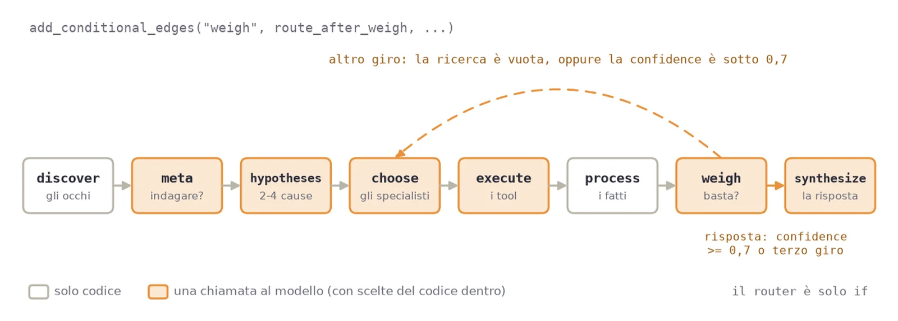
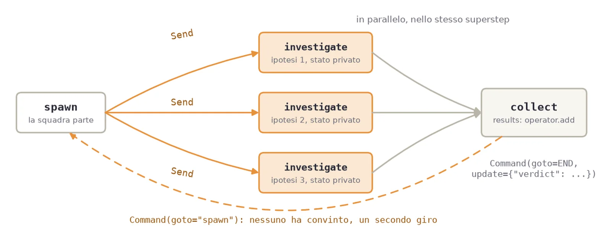

Questo è il laboratorio di [L'incidente non parla PromQL](/blog/verificare/observability/incidente-non-parla-promql/). Lì il sistema del talk era raccontato con le sue misure. Qui gli stessi meccanismi sono comandi da lanciare sul repo [observability-agent-lab](https://github.com/monte97/observability-agent-lab), con l'output atteso sotto ognuno.

Alla fine avrete:

1. visto un modello scrivere query valide che non trovano niente;
2. tolto la query al modello, con un `enum` letto dal sistema e il codice che la compone;
3. fatto girare il grafo [LangGraph](https://www.langchain.com/langgraph) dell'indagine, chiuso da un router di `if`;
4. rotto il sistema due volte, e visto il primo indizio passare da causa a sintomo;
5. misurato i quattro passi, e cambiato modello per vedere cosa si sposta.

## Lo scenario

Il sistema osservato è una pipeline IoT, con quattro tappe:

| Servizio | Cosa fa | Scrive su |
|---|---|---|
| `device-gateway` | riceve i messaggi dei dispositivi | `telemetry.raw` (Kafka) |
| `normalizer` | ripulisce i messaggi | `telemetry.clean` (Kafka) |
| `store` | legge i messaggi puliti | MongoDB |

Ogni servizio emette log, metriche e trace in OTLP. Il Collector li manda a [Loki](https://grafana.com/oss/loki/), [Mimir](https://grafana.com/oss/mimir/) e [Tempo](https://grafana.com/oss/tempo/), e l'agente interroga i primi due.

> **Per approfondire**: come si strumenta un servizio con OpenTelemetry e si porta tutto su Grafana è nella [serie sull'osservabilità](/blog/verificare/observability/).

I guasti del laboratorio sono due:

| Guasto | Comando | Cosa si vede | La causa |
|---|---|---|---|
| store fermo | `make incident` | store tace | store |
| normalizer fermo | `make incident-upstream` | tacciono normalizer e store | normalizer, a monte |

## Prerequisiti

- Docker con Compose v2;
- Python fra 3.10 e 3.14;
- una chiave API Anthropic, o di un altro provider (vedi «Il modello»).

Il resto lo installa `make setup`: un virtualenv con LangGraph e [LiteLLM](https://docs.litellm.ai/), che fa da client verso il modello.

### Il modello

Il laboratorio è misurato con tre modelli Claude. Si sceglie con `AGENT_MODEL` nel file `.env`:

| `AGENT_MODEL` | Ruolo |
|---|---|
| `anthropic/claude-sonnet-5-5` | il riferimento: i numeri dell'articolo vengono da qui |
| `anthropic/claude-opus-5-5` | il più capace, e il più prudente sui punteggi |
| `anthropic/claude-haiku-5-5` | il più economico |

#### Usare un altro provider

Ogni chiamata al modello passa da [LiteLLM](https://docs.litellm.ai/docs/providers), che è l'unico punto del codice che parla con il modello (`common/llm.py`). Basta cambiare il `.env`, e ci sono due strade.

**Un provider ospitato.** `AGENT_MODEL` ha la forma `provider/modello`, e LiteLLM legge dal `.env` la chiave di quel provider:

```bash
# .env
AGENT_MODEL=openai/<modello>
OPENAI_API_KEY=...
# oppure: mistral/<modello> con MISTRAL_API_KEY, gemini/<modello> con GEMINI_API_KEY
```

**Un gateway o un server locale.** `AGENT_MODEL` è il nome del modello senza barra, così come lo elenca l'endpoint. La richiesta va all'indirizzo compatibile OpenAI scritto in `LLM_BASE_URL`:

```bash
# .env, con LM Studio
AGENT_MODEL=<nome del modello in LM Studio>
LLM_BASE_URL=http://localhost:1234/v1
LLM_API_KEY=                  # vuota per un server locale; un gateway di solito la vuole
```

Con Ollama l'indirizzo è `http://localhost:11434/v1`, con vLLM quello su cui l'avete avviato.

Tre cose da sapere prima di provare:

- **Le due strade non si mescolano.** Un nome con la barra non va mai a `LLM_BASE_URL`, e un nome senza barra non legge mai la chiave di un provider. Se compare un errore di modello sconosciuto, quasi sempre è perché le due strade sono state mescolate.
- **Il modello deve saper chiamare gli strumenti.** Un modello che risponde a parole dove serve una chiamata viene sollecitato una volta, poi la risposta conta come fallita. Con i modelli piccoli in locale succede spesso.
- **I numeri dell'articolo sono misurati solo con Claude.** Con un altro modello i comandi sono gli stessi, ma le misure dei passi vanno rifatte. Per questo esiste `make compare`.

Dopo il cambio, `make check` dice se nel `.env` c'è una chiave, oppure un `LLM_BASE_URL` per un server locale che non ne vuole. Le istruzioni complete stanno in `SETUP.md` del repo, alla sezione «Pick your model».

> **Attenzione**: un modello non è deterministico. Rifacendo gli stessi comandi le risposte cambiano nella forma, e le misure di qualche punto. Quello che resta stabile da un giro all'altro è segnato sotto ogni passo, in «Cosa notare».

L'agente non accetta prosa dove si aspetta una chiamata a uno strumento, e con altri provider lo impone con `tool_choice="required"`. Claude Sonnet 5.5 e Opus 5.5 rifiutano una scelta forzata con un errore 400, come dice la [guida di migrazione](https://platform.claude.com/docs/en/models/sonnet-5-5/migration-guide). Per questo `common/llm.py` manda `tool_choice="auto"` ai modelli Claude, e se il modello risponde a parole riprova una volta, poi conta la risposta come fallita.

## Passo 0 · Avvio

```bash
git clone --recurse-submodules https://github.com/monte97/observability-agent-lab
cd observability-agent-lab
make setup                # virtualenv, dipendenze, .env copiato da .env.example
$EDITOR .env              # ANTHROPIC_API_KEY, e AGENT_MODEL se non volete Sonnet
make up                   # ~13 container, la prima volta scarica le immagini
```

`--recurse-submodules` porta con sé `stack/`, il sistema osservato. La chiave va solo in `.env`, che sta in `.gitignore`.

Dopo `make up` bisogna aspettare due minuti: il generatore di traffico deve produrre log prima che ci sia qualcosa da trovare. Poi:

```bash
make check
make stack-state
```

```
  http://localhost:3100/loki/api/v1/labels             200
  http://localhost:3200/api/echo                       200
  http://localhost:9009/prometheus/api/v1/labels       200
  venv: ok
  model key: ok
```

```
services: ['device-gateway', 'normalizer', 'store']
silent  : none
metrics : 223 | labels: 81
```

`make check` stampa prima lo stato dei container, qui tagliato: devono essere tutti `Up`.

**Cosa notare:**

- `make stack-state` mostra quello che l'agente vedrà a ogni domanda: i servizi letti dai log, le metriche e le etichette di Mimir, i servizi muti;
- nessuno ha scritto quell'elenco a mano. Lo costruisce `common/discovery.py` interrogando i backend, senza chiamare il modello.

## Passo 1 · Il modello scrive la query

Lo step `01-the-model-writes` dà al modello la domanda e gli chiede la query.

```bash
make ask STEP=01 Q="which log lines did the store service produce recently?"
```

```
  step 1: loki_query -> 200 results   {service_name="store"}

Answer: The `loki_query` returned 200 results, and the first three visible lines are all
"stored record from telemetry.clean". [...]

  model calls: 2 · 4.9s
```

Su questa domanda il modello ha indovinato l'etichetta, e la risposta è giusta. Per le altre c'è `make bench`, che misura lo step su cinque domande con la query di riferimento, con tre controlli per ciascuna: la query è valida (L1), tornano dati (L2), i dati sono quelli giusti (L3).

```bash
make bench STEP=01
```

```
Step: 01-the-model-writes
Model: anthropic/claude-sonnet-5-5
Window: last 10 minutes

  OK  logs-of-a-service        L1=1 L2=1 L3=1
      filtered-by-level        L1=1 L2=0 L3=0  valid query, no data
      logs-of-two-services     L1=1 L2=0 L3=0  valid query, no data
      jvm-classes              L1=1 L2=0 L3=0  valid query, no data
      not-covered              L1=1 L2=1 L3=0  answered a question it cannot answer

L3: 1/5 (fixed denominator — declining still counts as a miss unless declining was correct)
Per-question detail in results_bench_01.csv
```

Le query scritte dal modello stanno in `results_bench_01.csv`. Due righe del mio giro:

| Domanda | Query del modello | Esito |
|---|---|---|
| `filtered-by-level` | `{app="normalizer"} \| logfmt \| level="info"` | valida, nessun dato |
| `not-covered` | `sum(increase(cart_abandoned_total[24h]))` | torna un numero, a una domanda senza risposta |

**Cosa notare:**

- tutte e cinque le query sono valide, e passano L1. Il primo controllo è quello che si vede a schermo, ed è il più facile da scambiare per un successo;
- il nome dell'etichetta lo sceglie il modello. Su questo stack si chiama `service_name`, e `{app="normalizer"}`, scritto bene, non trova niente;
- sulla domanda impossibile il modello inventa una metrica e risponde con un numero.

## Passo 2 · Il modello sceglie, il codice scrive

Lo step `02-the-model-picks` cambia il compito: il modello sceglie uno strumento e i suoi parametri, e i valori ammessi sono un `enum` riempito da `discover`.

```python
# common/tools.py (estratto)
def loki_schema(services: list[str]) -> dict:
    return {
        "type": "function",
        "function": {
            "name": "loki_query",
            "description": "Read recent log lines for one or more services.",
            "parameters": {
                "type": "object",
                "properties": {
                    "services": {
                        "type": "array",
                        "items": {"enum": list(services)},  # <- discovered at runtime
                        "description": "Services to read logs from.",
                    },
                    # ... "level", un altro enum: error, warn, info, debug
                },
                "required": ["services"],
            },
        },
    }
```

La query la scrive una seconda funzione, che il modello non vede mai:

```python
# common/tools.py (commenti tolti)
def loki_compose(services: list[str], level: str | None = None) -> str:
    """Build LogQL. The model never sees this string, only its parameters."""
    if not services:
        raise ValueError("loki_query needs at least one service")
    query = '{service_name=~"%s"}' % "|".join(services)
    if level:
        query += f' | detected_level="{level}"'
    return query
```

Stessa domanda, sullo step 02:

```bash
make ask STEP=02 Q="which log lines did the store service produce recently?"
make bench STEP=02
```

```
  step 1: loki_query -> 200 results   {service_name=~"store"}

Answer: The `loki_query` returned 200 results, and the first three shown were all the same
line: "stored record from telemetry.clean". [...]

  model calls: 2 · 5.4s
```

La query è cambiata di poco, `=~` invece di `=`: adesso la scrive `loki_compose`, e il modello ha scelto solo `services: ["store"]`.

```
Step: 02-the-model-picks
Model: anthropic/claude-sonnet-5-5
Window: last 10 minutes
  OK  logs-of-a-service        L1=1 L2=1 L3=1
  OK  filtered-by-level        L1=1 L2=1 L3=1
  OK  logs-of-two-services     L1=1 L2=1 L3=1
  OK  jvm-classes              L1=1 L2=1 L3=1
      not-covered              L1=1 L2=1 L3=0  answered a question it cannot answer
L3: 4/5 (fixed denominator — declining still counts as a miss unless declining was correct)
```

**Cosa notare:**

- `service_name` adesso sta nel codice, scritto una volta. Un servizio che non esiste non entra nell'`enum`, quindi il modello non lo può chiedere;
- l'ultima delle cinque domande non ha risposta su questo sistema. Per dirlo il modello ha uno strumento apposta, `no_tool_covers_this`, la sentinella, e a volte non lo usa: risponde con lo strumento meno sbagliato. Il «non lo so» resta una scelta del modello.

## Passo 3 · Il grafo dell'indagine

Lo step `03-the-graph` serve quando le chiamate diventano più di una e qualcuno deve decidere l'ordine. Il grafo ha otto nodi:

| Nodo | Chi decide |
|---|---|
| `discover` | codice: legge servizi, metriche e servizi muti |
| `meta` | modello: è una ricerca puntuale o un sintomo da indagare? |
| `hypotheses` | codice, un'ipotesi per ogni servizio muto; poi modello, da due a quattro cause |
| `choose` | codice, quale ipotesi indagare; modello, quale specialista |
| `execute` | modello, lo strumento e i parametri; codice, la query |
| `process` | codice: riduce la risposta grezza a fatti |
| `weigh` | modello, un punteggio per ipotesi; codice, le correzioni |
| `synthesize` | modello, le prove; codice, la causa scritta così com'è |



Il collegamento sta in `build_graph`:

```python
# 03-the-graph/graph.py (estratto)
graph = StateGraph(State)
graph.add_node("discover", lambda s: node_discover(s, start, end))
graph.add_node("meta", lambda s: node_meta(s, model))
# ... hypotheses, choose, execute, process, weigh, synthesize
graph.add_edge(START, "discover")
# ... discover -> meta -> hypotheses -> choose -> execute -> process -> weigh
graph.add_conditional_edges("weigh", route_after_weigh,
                            {"choose": "choose", "synthesize": "synthesize"})
graph.add_edge("synthesize", END)
return graph.compile()
```

Ogni nodo è una funzione che riceve lo [stato](https://docs.langchain.com/oss/python/langgraph/graph-api#state), un `TypedDict`, e restituisce solo i campi che ha cambiato. L'arco condizionale dopo `weigh` è il router, ed è fatto solo di `if`:

```python
# 03-the-graph/graph.py (commento sopra la funzione tolto)
def route_after_weigh(state: State) -> str:
    """Another cycle, or the answer? Plain `if`s on the evidence, never the model."""
    if state.get("stop") or state.get("error") or (state.get("cycle") or 0) >= MAX_CYCLES:
        return "synthesize"
    last = (state.get("findings") or [{}])[-1]
    if last.get("sentinel"):
        undecided = [h for h in state.get("hypotheses") or [] if not h.get("discarded")]
        return "choose" if undecided and not state.get("direct") else "synthesize"
    if last.get("hits") == 0 and not state.get("silence"):
        return "choose"
    return "synthesize" if best(state) >= CONFIDENCE_THRESHOLD else "choose"
```

In ordine:

1. al terzo giro, o se qualcosa si è rotto, si risponde;
2. se lo specialista ha scelto la sentinella e restano ipotesi aperte, si prova con un'altra;
3. se l'ultima ricerca è tornata vuota, e quel vuoto non è il silenzio di un servizio che conta come prova, si torna a `choose`;
4. solo alla fine conta la confidence migliore, contro la soglia di 0,7.

### Il silenzio lo pesa il codice

Dentro `weigh` il modello dà un punteggio a ogni ipotesi, e `apply_guardrails` lo corregge dove i fatti dicono altro, anche sul silenzio. Prima della correzione sul silenzio, con store fermo, Sonnet 5.5 leggeva tre volte i log di store, trovava zero righe, e dava questo:

```
  hypotheses:
     0.5  The normalizer is no longer delivering data to store. [...] store would be idle
          because it receives nothing, not because it is broken. [not investigated]
     0.2  store is down: it wrote log lines until 2 minutes ago and nothing since [from the code]
```

Un servizio che tace può essere spento, o solo senza lavoro, e il silenzio da solo non li distingue: il modello fa bene a dubitare. Il sistema del palco aveva il fatto che li separa, le trace di chi scrive ancora. Il repo semplifica e tratta un servizio muto come fermo, una regola del sistema che quindi scrive il codice:

```python
# 03-the-graph/graph.py, apply_guardrails (estratto)
if h.get("silent") and not h.get("silence_seen"):
    h["confidence"] = min(h.get("confidence", 0), CONFIDENCE_THRESHOLD - 0.01)
elif h.get("silent"):
    h["confidence"] = max(h.get("confidence", 0), CONFIDENCE_THRESHOLD)
```

Finché il silenzio non è stato visto, l'ipotesi resta sotto la soglia qualunque cosa dica il modello. Quando è stato visto, sale alla soglia, anche se il modello dubita.

Le parti del grafo che non chiamano il modello hanno i loro test, che girano senza stack e senza chiave:

```bash
make test
```

```
rule: ok
trigger: ok
silence: ok
guardrails: ok
team: ok
llm.tool_call: ok
llm.call_tool: ok
```

## Passo 4 · Primo guasto: store fermo

```bash
make incident && sleep 150      # ferma store, e aspetta che esca dalla finestra
make scenario STEP=03 MINUTES=2 Q="Data no longer reaches MongoDB. What is going on?"
make healthy
```

`MINUTES=2` restringe la finestra di osservazione a due minuti, così dopo 150 secondi store risulta muto. `scenario` tratta la domanda come un sintomo da indagare.

```
  step 1: logs: loki_query -> 0 results   {service_name=~"store"}

  hypotheses:
     0.7  store is down: it wrote log lines until 2 minutes ago and nothing since [from the code]
     0.5  The store service has crashed or is stuck (OOM kill, panic, deadlock, or failed
          deploy). [...] [not investigated]
     0.5  The store service cannot reach MongoDB. [...]
     0.5  The normalizer is no longer delivering data to store. [...]
     0.5  The device-gateway has stopped ingesting or forwarding device data. [...] [not investigated]

Answer: store is down: it wrote log lines until 2 minutes ago and nothing since.
The log query `{service_name=~"store"}` returned no lines in the observation window. [...]

  model calls: 5 · 18.3s
```

**Cosa notare:**

- la prima ipotesi l'ha scritta il codice («store is down: it wrote log lines until N minutes ago and nothing since»), marcata `[from the code]`;
- la query che la conferma l'ha scritta il codice anche lei: tutti i log di store, senza filtri. Il risultato vuoto è la prova;
- lo 0.7 non l'ha deciso il modello: il silenzio è stato visto, e `apply_guardrails` ha portato l'ipotesi alla soglia;
- qui il primo indizio che regge è la causa.

## Passo 5 · Secondo guasto: normalizer fermo

Normalizer alimenta store: se si ferma lui, un attimo dopo tace anche store, che non riceve più niente.

```bash
make incident-upstream && sleep 150
make scenario STEP=03 MINUTES=2 Q="Data no longer reaches MongoDB. What is going on?"
```

```
  step 1: logs: loki_query -> 0 results   {service_name=~"store"}

  hypotheses:
     0.7  store is down: it wrote log lines until 2 minutes ago and nothing since [from the code]
     0.5  normalizer is down: it wrote log lines until 2 minutes ago and nothing since [from the code, not investigated]
     [...]

Answer: store is down: it wrote log lines until 2 minutes ago and nothing since.

  model calls: 5 · 16.5s
```

Lo step 03 vede due servizi muti e scrive un'ipotesi per ciascuno. Il coordinatore indaga la prima, store, il silenzio la conferma e il router chiude: la risposta è il sintomo. L'ipotesi su normalizer, la causa, resta `not investigated`.

Lo step `04-the-team` aggiunge una regola. In `discover`, `order_by_rule` legge chi alimenta chi e mette in testa il servizio a monte:

```yaml
# 04-the-team/dependencies.yaml
- from: device-gateway
  to: normalizer
  via: telemetry.raw
- from: normalizer
  to: store
  via: telemetry.clean
```

```python
# 04-the-team/graph.py (docstring tolta)
def order_by_rule(muted: list[dict], dependencies: list[dict]) -> list[dict]:
    edges = chains(muted, dependencies)
    linked = {e["from"] for e in edges} | {e["to"] for e in edges}

    def upstream(service: str, seen: frozenset = frozenset()) -> int:
        parents = [e["from"] for e in edges if e["to"] == service and e["from"] not in seen]
        return max((1 + upstream(p, seen | {service}) for p in parents), default=0)

    return sorted(muted, key=lambda m: (m["service"] not in linked, upstream(m["service"])))
```

Stessa domanda, sullo step 04, poi il sistema torna sano:

```bash
make scenario STEP=04 MINUTES=2 Q="Data no longer reaches MongoDB. What is going on?"
make healthy
```

```
  step 1: logs: loki_query -> 0 results   {service_name=~"normalizer"}
  step 2: team/logs: loki_query -> 0 results   {service_name=~"normalizer"}
  step 3: team/logs: loki_query -> 0 results   {service_name=~"store"}
  step 4: team/logs: loki_query -> 200 results   {service_name=~"normalizer|store|device-gateway"}

  hypotheses:
    0.72  normalizer is down: it wrote log lines until 2 minutes ago and nothing since [from the code]
    0.72  store is down: it wrote log lines until 2 minutes ago and nothing since [from the code]
     [...]

  route: team (trigger: chain normalizer -> store; 1 round(s); 2 hypotheses held on equal
         evidence; the rule picked the one upstream)

Answer: normalizer is down: it wrote log lines until 2 minutes ago and nothing since.

  model calls: 14 · 19.2s
```

**Cosa notare:**

- la riga `route: team (trigger: chain normalizer -> store ...)`: la squadra è partita perché il codice ha visto una catena fra servizi muti, non perché il modello l'ha chiesta;
- la causa in testa è normalizer: la regola l'ha messa lì, e il silenzio l'ha confermata;
- le due ipotesi del codice finiscono a pari punteggio, 0.72, perché le prove sono dello stesso tipo. A scegliere quella a monte è `collect`, con la stessa regola di `discover`: «the rule picked the one upstream».

## Passo 6 · Dentro la squadra

La squadra è un sottografo con il suo stato. Tre pezzi di LangGraph la fanno funzionare:

| Pezzo | Dove | Cosa fa |
|---|---|---|
| [`Send`](https://docs.langchain.com/oss/python/langgraph/graph-api#send) | `send_agents` | lancia un nodo `investigate` per ciascuna delle tre ipotesi più alte, in parallelo |
| [reducer](https://docs.langchain.com/oss/python/langgraph/graph-api#reducers) | `results: Annotated[list[dict], operator.add]` | accoda i risultati dei tre agenti, che scrivono nello stesso passo |
| [`Command`](https://docs.langchain.com/oss/python/langgraph/graph-api#command) | `node_collect` | sceglie il nodo successivo e scrive nello stato in un colpo: un secondo giro, o il verdetto |

```python
# 04-the-team/graph.py (estratto di send_agents)
return [Send("investigate", {"question": state["question"], "topology": state["topology"],
                             "hypothesis": hypotheses[i], "index": i, "round": state["round"],
                             "before": before.get(i)})
        for i in top]
```

```python
# 04-the-team/graph.py (estratto di node_collect)
if top < CONFIDENCE_THRESHOLD and state["round"] < 2:
    return Command(goto="spawn")   # nobody convinced: one more round, then stop
# ...
return Command(goto=END, update={"verdict": {"chosen": chosen, "note": note}})
```



**Cosa notare:**

- i due agenti su normalizer e store portano prove dello stesso tipo, il silenzio. Il confronto fra agenti da solo non le separa: quando reggono tutte e due, `collect` le ordina con la stessa regola di `discover`;
- senza reducer, tre scritture su `results` nello stesso passo farebbero alzare a LangGraph un `InvalidUpdateError`.

## Passo 7 · Misurare, e cambiare modello

Un'indagine sola non dice niente: il modello cambia risposta da un giro all'altro. `make compare` fa girare gli step 03 e 04 su tre domande, tre volte ciascuna, e conta tre esiti:

| Esito | Vuol dire |
|---|---|
| `RIGHT` | conclude, e il primo servizio nominato è quello fermo |
| `OPEN` | «Inconclusive», qualunque cosa elenchi come ancora aperto |
| `WRONG` | conclude su un altro servizio, o fallisce |

```bash
make incident-upstream && sleep 150
make compare SERVICE=normalizer RUNS=3
make healthy
```

```
03-the-graph         right 0/9  open 0  wrong 9  calls 5.0  seconds 16.2
04-the-team          right 8/9  open 0  wrong 1  calls 13.7  seconds 24.2
```

Per cambiare modello basta la variabile, senza toccare `.env`:

```bash
make incident-upstream && sleep 150
AGENT_MODEL=anthropic/claude-opus-5-5 make compare SERVICE=normalizer RUNS=3
AGENT_MODEL=anthropic/claude-haiku-5-5 make compare SERVICE=normalizer RUNS=3
make healthy
```

Le mie misure con normalizer fermo, nove indagini per step, tutte con lo stesso codice:

| Modello | Step | Causa giusta | `OPEN` | Sintomo (store) | Chiamate per indagine |
|---|---|---|---|---|---|
| Sonnet 5.5 | 03 | 0 | 0 | 9 | 5,0 |
| Sonnet 5.5 | 04 | 8 | 0 | 1 | 13,7 |
| Opus 5.5 | 03 | 0 | 0 | 9 | 5,0 |
| Opus 5.5 | 04 | 9 | 0 | 0 | 13,4 |
| Haiku 5.5 | 03 | 0 | 0 | 9 | 5,0 |
| Haiku 5.5 | 04 | 5 | 0 | 4 | 13,4 |

> **Nota**: misure del 2 novembre 2026, sul repo con la regola del silenzio nel codice (passo 3).

**Cosa notare:**

- lo step 03 si comporta allo stesso modo con tutti e tre i modelli: nove volte il sintomo, a 5 chiamate. Lì decidono il codice e il silenzio, e il modello non sposta niente;
- prima che il silenzio lo pesasse il codice (passo 3), lo stesso Opus 5.5 con la squadra non chiudeva mai: nove «Inconclusive» su nove, a 21 chiamate. Era il più prudente nel dare un punteggio, e la soglia scelta a mano per lui era troppo alta. Con il fatto nel codice arriva a 9 su 9;
- Haiku 5.5 sullo step 04 dice «store è fermo» quattro volte su nove. Nella squadra restano decisioni del modello, quale specialista e quanto pesa una prova, e il modello più piccolo lì sbaglia di più. Una risposta sbagliata che conclude costa più di un «Inconclusive».

## Cosa resta fuori

- **Il sistema del palco.** Il repo ne riscrive i meccanismi in piccolo, non le regole: qui un servizio muto vale sempre come fermo, e le dipendenze sono scritte a mano in `dependencies.yaml`.
- **Tempo.** Gli specialisti del repo leggono log e metriche. Le trace le usava il sistema del palco per ricavare chi alimenta chi.
- **La memoria.** Ogni indagine riparte da zero.

> **Per approfondire**: le misure del sistema del talk, sulle venti domande e sui guasti con 33 indagini ciascuno, sono nella [prima parte](/blog/verificare/observability/incidente-non-parla-promql/).

Il primo passo su un agente proprio è lo stesso di questo laboratorio: per ogni nodo, chiedersi chi scrive la query e chi decide quando basta. Dove esiste un fatto che può decidere al posto del modello, quel fatto va nel codice, e una misura come `make compare` dice se è servito.
