I dati di telemetria non arrivano più su MongoDB. Il sistema è una pipeline IoT: i dispositivi parlano con `device-gateway`, `normalizer` ripulisce i messaggi e li pubblica su una coda, `store` li legge e li scrive sul database. Chi è di turno apre [Grafana](https://grafana.com/oss/grafana/) e trova due segnali. Nei log, `store` non dice più niente. Nelle trace, `normalizer` gli manda ancora messaggi su `telemetry.clean`, adesso. Store è spento, o solo senza lavoro? Nessuno dei due segnali, da solo, lo dice.

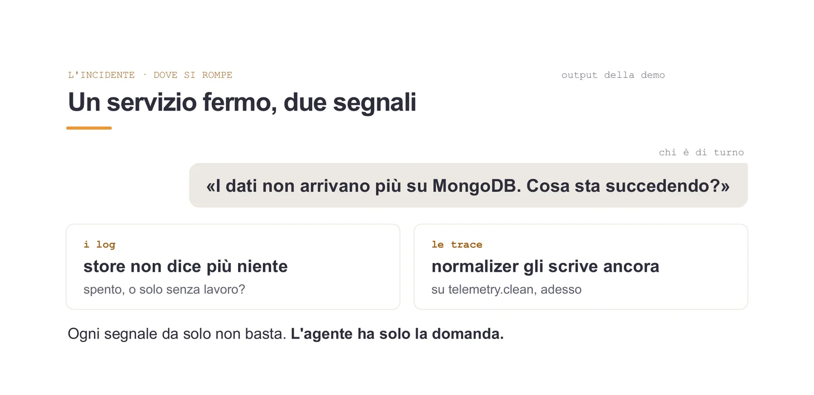

Per rispondere bisogna sapere in quale backend cercare e con quale sintassi: [LogQL](https://grafana.com/docs/loki/latest/query/) per [Loki](https://grafana.com/oss/loki/), [TraceQL](https://grafana.com/docs/tempo/latest/traceql/) per [Tempo](https://grafana.com/oss/tempo/), [PromQL](https://prometheus.io/docs/prometheus/latest/querying/basics/) per [Mimir](https://grafana.com/oss/mimir/). Le dashboard rispondono alle domande che qualcuno aveva previsto. Io vorrei chiedere in italiano: «dimmi cosa è successo».

Al [DevFest Milano 2026](/talks/incidente-non-parla-promql/) ho mostrato un agente [LangGraph](https://www.langchain.com/langgraph) che fa questo sopra uno stack [OpenTelemetry](https://opentelemetry.io/) con Loki, Tempo e Mimir, costruito un pezzo alla volta e misurato a ogni passo. Le [slide](/files/talk-promql-devfest-milano-2026.pdf) sono pubbliche. Qui racconto il sistema e le misure, rifatte il 3 novembre con Claude Sonnet 5.5: le slide hanno quelle del giorno del talk, prese con un altro modello, e alcuni numeri sono diversi.

> **Per approfondire**: come si costruisce in LangGraph, passo per passo sul codice di [observability-agent-lab](https://github.com/monte97/observability-agent-lab), che riscrive gli stessi meccanismi in piccolo, è nel [laboratorio della seconda parte](/blog/verificare/observability/agente-langgraph-osservabilita/).

## Un formato per i segnali, tre lingue per le query

> **Per approfondire**: come si strumenta un'applicazione con OpenTelemetry e si porta tutto su Grafana, da `console.log` al tracing distribuito, è nella [serie sull'osservabilità](/blog/verificare/observability/).

Sotto l'agente c'è uno stack OpenTelemetry classico:

- gli SDK di OpenTelemetry raccolgono log, metriche e trace in un formato solo, OTLP;
- lo stesso trace ID compare nei log e negli span, e permette ai backend di correlarli;
- il [Collector](https://opentelemetry.io/docs/collector/) riceve tutto e manda ogni segnale al suo backend: log a Loki, metriche a Mimir, trace a Tempo;
- Grafana sta davanti ai tre e li mostra insieme.

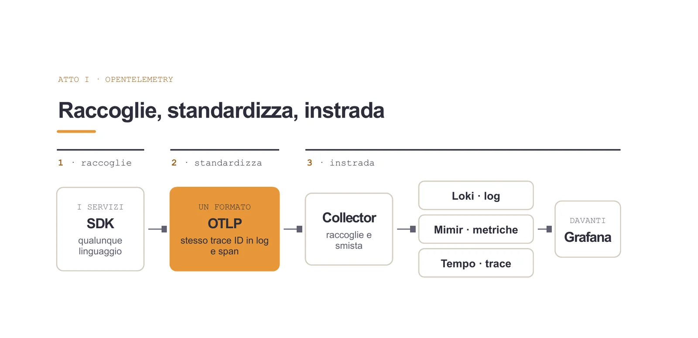

Lo standard disaccoppia l'applicazione dai backend: si strumenta una volta, e il backend si cambia senza toccare il codice. Le query però restano tre, ognuna nella lingua del suo backend, ed è lì che entra l'agente.

> **Nota**: la correlazione fra log e trace è nel [tutorial sul distributed tracing](/blog/verificare/observability/04-correlation/). Dove mettere il Collector e cosa indicizzare decide quanto costa lo stack, ed è in [un articolo a parte](/blog/verificare/observability/dalla-strumentazione-allo-storage/).

## Una risposta è giusta se torna gli stessi dati della query di riferimento

Prima di costruire qualcosa ho deciso come dire «funziona». Venti domande sul sistema della demo, e per ognuna la query di riferimento con la risposta giusta già nota. Una risposta passa tre controlli, con un crescendo per quanto riguarda i requisiti di valutazione:

1. il backend accetta la query, cioè la sintassi è valida;
2. tornano dati;
3. i dati sono gli stessi della query di riferimento.

Conta solo il terzo. Il primo è quello che si vede a schermo, ed è il più facile da confondere con un successo.

## Il modello che scrive la query sbaglia anche quando i nomi sono giusti

La cosa che si prova per prima è quella che verrebbe in mente a tutti: un buon modello, un buon prompt, la domanda, e il modello scrive la query.

Con la sola domanda il modello inventa i nomi delle metriche, e tornano dati 6 volte su 20. Allora faccio la cosa ovvia: nel prompt metto l'elenco dei nomi veri, letti dal sistema. Le query tornano dati 18 volte su 20, sempre le stesse nelle tre esecuzioni. Le risposte giuste, però, sono 10,3 su 20 in media.

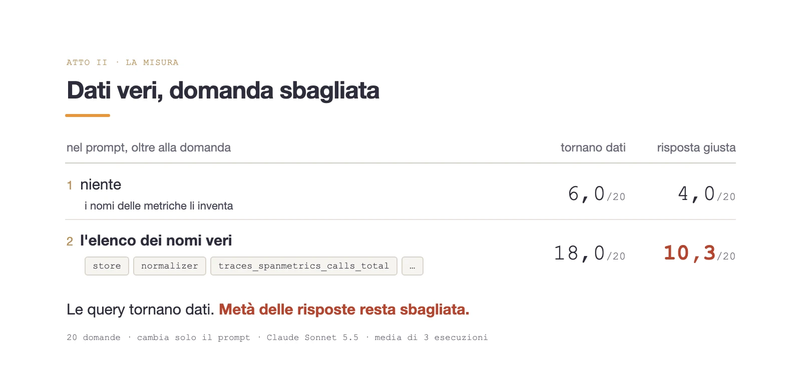

Le risposte sbagliate usano nomi veri e tornano dati, ma non i dati della query di riferimento: quasi sempre il modello somma o filtra a modo suo. Alla domanda «quante chiamate sono state registrate per ciascuna operazione?» scrive `sum by (span_name) (traces_spanmetrics_calls_total)`. La metrica è quella giusta, quella che il Collector ricava dagli span per le [metriche RED](/blog/verificare/testing/red-use-quando-e-perche/), ma la somma per nome mette insieme le operazioni con lo stesso nome in servizi diversi. La query torna dati, e la risposta è sbagliata lo stesso.

## Il modello sceglie, il codice scrive

Il passo successivo cambia il compito del modello: da scrivere a scegliere. Con il tool calling il modello sceglie una funzione e un valore fra quelli che esistono, per esempio quale servizio interrogare su Loki. La query la compone il codice, e il modello non la vede mai.

Le conseguenze sono tre:

- la sintassi non si sbaglia, perché la scrive il codice;
- un nome inventato si ferma prima di arrivare al backend;
- la scelta si può ancora sbagliare, perché anche un valore valido può essere quello sbagliato.

Resta da decidere chi scrive l'elenco dei valori ammessi. Se lo scrivo io, l'agente vale solo per il mio sistema. Per questo a ogni domanda un nodo `discover` interroga i backend e costruisce l'elenco dei servizi e delle metriche, senza chiamare il modello. Sul sistema della demo trova 3 servizi, 221 metriche e 54 pannelli. L'elenco diventa un `enum` nello schema del tool, e il codice ricontrolla comunque ogni valore prima di chiamare il backend.

Da qui posso dire cosa intendo per agente. Un ruolo, cioè due righe di prompt che dicono di cosa si occupa. I suoi strumenti, solo i suoi. Il suo vocabolario, i valori che `discover` ha appena letto dal sistema. Una chiamata al modello che sceglie strumento e parametri. Il resto è codice.

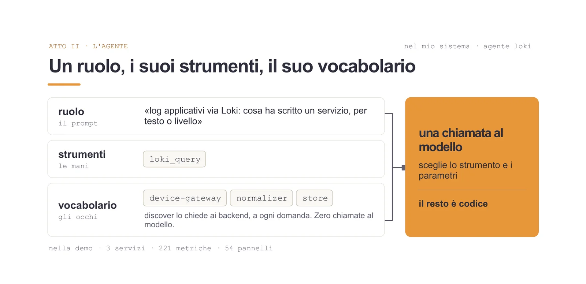

## Un guasto fa più di una domanda

Un agente risponde a una domanda puntuale. Un guasto ha più cause possibili, in posti diversi, e qualcuno deve decidere dove guardare e quando basta.

La prima idea è un agente solo con tutti gli strumenti. Si può fare, ma ha tre problemi noti in generale, che qui non ho misurato:

- più strumenti ha davanti, più è facile che scelga quello sbagliato;
- il contesto cresce a ogni giro (schemi, risultati, istruzioni), e più cresce peggio il modello usa quello che c'è dentro, il fenomeno che il [report di Chroma](https://research.trychroma.com/context-rot) chiama context rot;
- un prompt solo per tutti i ruoli resta generico, o finisce con istruzioni che si contraddicono.

Allora ho diviso il lavoro come lo divido io quando indago un guasto. Mi chiedo cosa potrebbe essere, chi va a guardare, se quello che ho trovato basta e cosa rispondo. Ognuna di queste domande è diventata un nodo di un grafo LangGraph, con poche opzioni, il suo contesto e il suo prompt.

Il grafo ha otto nodi:

- `discover` legge dai backend servizi, metriche e pannelli, senza modello;
- `meta` decide se la domanda merita un'indagine;
- `ipotesi` propone da due a quattro cause candidate;
- `scegli` è il coordinatore: decide a quale specialista delegare (log, metriche, trace, pannelli, documentazione) vedendo solo i nomi e i mandati degli agenti, e lo specialista sceglie strumento e parametri nel suo vocabolario;
- `esegui` interroga il backend, senza modello;
- `processa` riduce la risposta grezza a fatti, senza modello;
- `pesa` dà un peso a ogni ipotesi alla luce dei fatti;
- `sintetizza` scrive la risposta.

Nel repo pubblico i nodi hanno i nomi in inglese: `hypotheses`, `choose`, `weigh` e così via. Il ciclo dell'indagine, decidere, agire, osservare, valutare, lo fa il grafo, un passo per nodo. Lo stato che i nodi si passano fa da memoria condivisa dell'indagine.

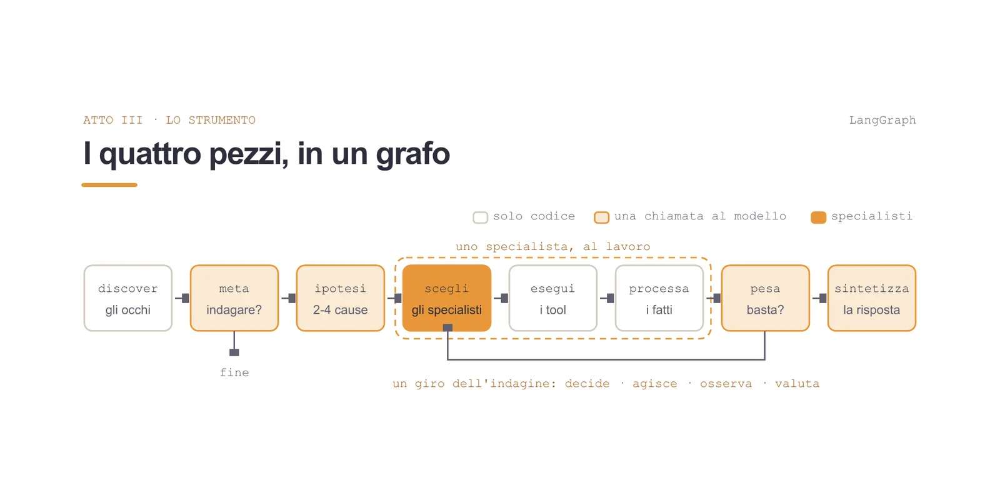

## Quando fermarsi lo decide il codice

Dopo `pesa` c'è un incrocio, ed è fatto solo di `if`. Nel sistema del palco i controlli vengono in quest'ordine:

1. se l'ultima ricerca è tornata vuota, si torna a `scegli`;
2. se ho sentito una fonte sola, si torna a `scegli` lo stesso, tranne quando un servizio tace e la documentazione dice che dovrebbe parlare: quel silenzio vale come prova;
3. solo a questo punto conta la confidence: chiudo se è almeno 0,7;
4. al terzo giro chiudo comunque.

La confidence da sola non basta. Ho fatto girare le venti domande tre volte a Claude Sonnet 5.5 e tre a Claude Haiku 5.5: nelle 120 risposte, sopra 0,7 di confidence c'è il 33,3% di quelle giuste e il 30,4% di quelle sbagliate. La confidence media delle sbagliate, 0,47, è perfino un po' più alta di quella delle giuste, 0,43.

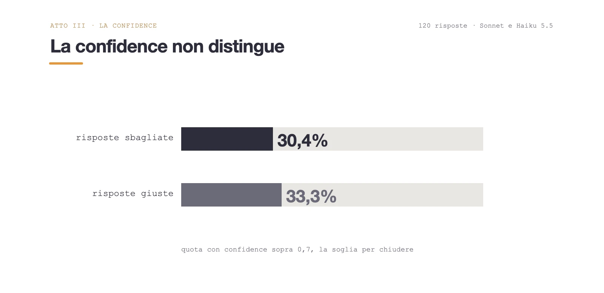

Il modello non può convincere questi controlli, proprio perché sono stupidi: nella versione più semplice del repo il router è una funzione di poche righe. Finiscono sempre, si leggono, si testano, e non cambiano se cambio modello. Le soglie però le ho scelte a mano, 0,7 e tre giri, e con quattro ipotesi e tre giri le ultime possono restare non indagate.

> **Per approfondire**: il router riga per riga, con i test che lo tengono fermo, è nel [passo 3 del laboratorio](/blog/verificare/observability/agente-langgraph-osservabilita/#passo-3--il-grafo-dellindagine).

Lo stesso principio vale dentro `pesa`. Il modello dà un numero da 0 a 1 a ogni ipotesi e può proporre di scartarne una. Il codice ha una regola: un'ipotesi che nessuno ha indagato non si scarta. Se il modello ci prova, la richiesta viene ignorata e l'ipotesi resta aperta, marcata come non indagata.

## Una causa probabile, le altre aperte

Sul guasto dell'apertura, con store fermo, ho fatto girare la domanda tre volte con Claude Sonnet 5.5. La risposta finale ha sempre questa forma:

- «store è fermo», a 0,85 in due esecuzioni e a 0,75 nella terza, con una prova: store tace da due minuti, e la documentazione dice che normalizer gli scrive su `telemetry.clean`;
- una seconda ipotesi fra 0,55 e 0,6, che ripete la prima con altre parole;
- tre ipotesi che nessuno ha indagato: store vivo ma senza MongoDB, un problema sulla coda, un problema a monte su normalizer o device-gateway.

La conclusione dichiara cosa resta aperto, e lo scrive anche nella risposta: «resta però aperta la distinzione tra processo davvero fermo e processo vivo ma bloccato nelle scritture». Nessuna regola unisce le ipotesi equivalenti, così il doppione resta lì con il suo peso, e anche per questo lo stop non si fida della confidence. Quello 0,85 resta una stima del modello, e la conclusione la valida una persona.

## Da 10 a 13 su 20, e l'errore che resta

Sulle stesse 20 domande, con Claude Sonnet 5.5, lo stesso criterio e lo stesso stack: il modello che scrive la query con l'elenco dei nomi veri risponde giusto 10,3 volte su 20, l'agente che sceglie con il codice che compone 13 su 20, in tutte e tre le esecuzioni. Il confronto ha differenze di protocollo che fanno parte di ciò che si confronta: l'agente ha fino a tre giri e sceglie lui il backend. Con tre esecuzioni è una distanza osservata, senza un intervallo di confidenza.

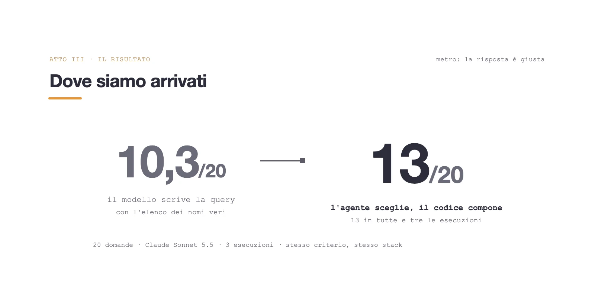

Con un modello forte la distanza si accorcia, e il guadagno principale è un altro: la sintassi e i nomi non sono più affidati al modello, e l'agente dà lo stesso risultato in tutte e tre le esecuzioni.

Fra le sette che restano c'è un errore che il vincolo non tocca. Alla domanda «il device-gateway sta accettando le richieste di ingest?» il coordinatore delega alle metriche, e lo specialista scrive una query valida, `sum(rate(http_server_request_duration_count[5m]))` raggruppata per codice di risposta e rotta. Tornano dati veri, i conteggi delle richieste HTTP. La risposta di riferimento era nei log: le righe «ingest accepted» che il gateway scrive per ogni telemetria accettata. Lo specialista ha lavorato bene e ha sbagliato il coordinatore, che vede solo i mandati degli agenti e per cui «richieste accettate» suona da metriche quanto da log. È successo in tutte e tre le esecuzioni.

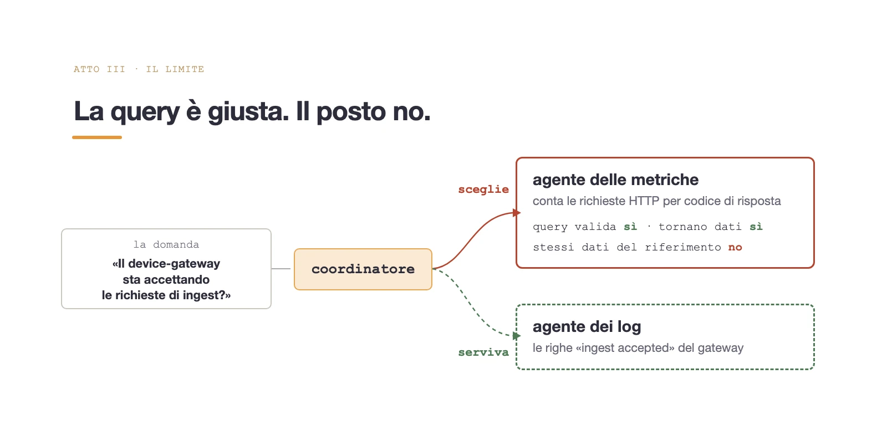

Il vincolo toglie l'errore di sintassi, ma l'errore di scelta resta: lo fa il coordinatore, e nessun `enum` lo tocca.

## Il primo indizio può essere il sintomo
Il coordinatore chiude alla prima ipotesi che regge, anche quando quell'ipotesi descrive il sintomo. L'ho visto mettendo a confronto due guasti, con 33 indagini ciascuno, tutte con Claude Sonnet 5.5.

- **Store fermo.** La prima ipotesi, «store è fermo», è la causa: 33 su 33.
- **Normalizer fermo.** Normalizer alimenta store, quindi tace lui e tace anche store, che non riceve più niente. La prima ipotesi è ancora «store è fermo», il silenzio la conferma e il coordinatore chiude. Stavolta è il sintomo, e la causa sta a monte: 4 su 33.

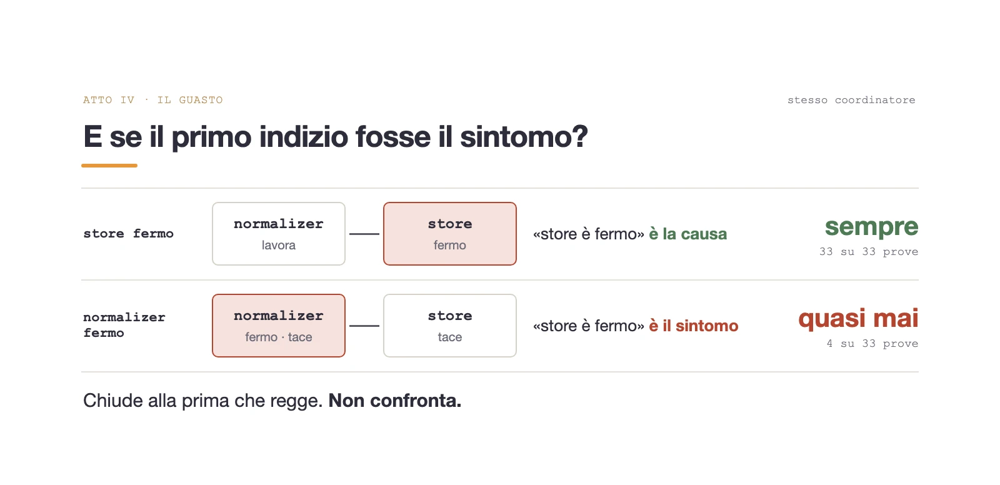

La prima risposta è stata una squadra: un agente per ipotesi, che indaga da solo con un ciclo e uno stato privati, e qualcuno che alla fine confronta. Dopo il confronto, un nodo di replica può rimandare due agenti al lavoro, ognuno con le prove dell'altro, una volta sola. In LangGraph è il pattern orchestrator-worker, costruito con `Send`, un reducer e `Command`.

> **Per approfondire**: la squadra sul codice del repo, con `Send`, il reducer e `Command`, è nel [passo 6 del laboratorio](/blog/verificare/observability/agente-langgraph-osservabilita/#passo-6--dentro-la-squadra).

Su normalizer fermo la squadra trova la causa 32 volte su 33, ma a 14 chiamate al modello per indagine, più del doppio delle 6,5 del coordinatore da solo. Ogni agente indaga la sua ipotesi, e il confronto finale deve separare due prove dello stesso tipo: l'agente che difende «normalizer è fermo» porta il silenzio di normalizer, quello che difende «store è fermo» porta il silenzio di store. Un servizio che tace può essere spento, o solo senza lavoro.

Il fatto che separa i due silenzi il sistema lo conosce già: chi alimenta chi. Nella finestra del guasto i due servizi tacciono tutti e due, ma nell'ora prima gli span c'erano. Le trace dicono che normalizer pubblicava su `telemetry.clean`, la documentazione dice che store legge da lì. Per questo `discover` legge anche chi alimenta chi, dalle trace e dalla documentazione, e il nodo che prepara le ipotesi applica una regola: se due servizi tacciono e uno alimenta l'altro, l'ipotesi su quello a monte va in testa. Il coordinatore resta com'è e indaga la prima, come ha sempre fatto.

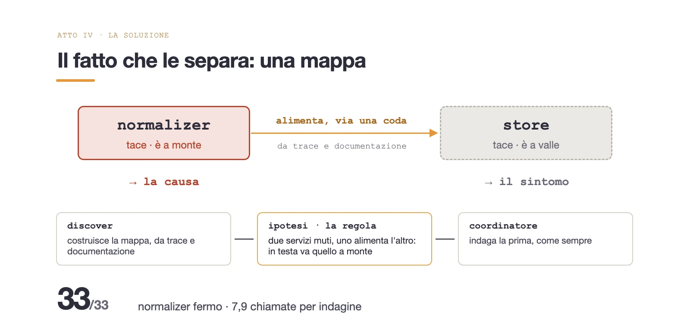

Stesso guasto, stesse 33 indagini: 33 su 33, a 7,9 chiamate per indagine. La squadra arriva quasi allo stesso punto pagando quasi il doppio; con la regola il fatto che separa i due silenzi sta nel codice, e il coordinatore non deve ricavarlo ogni volta.

La squadra l'ho tenuta, dietro un innesco deciso dal codice: una catena fra servizi muti, oppure due ipotesi sopra 0,7 dopo il primo giro. Su normalizer fermo arriva a 33 su 33, a 13,9 chiamate. Poi ho provato tre guasti senza una dipendenza scritta, dove la regola non può scattare, e la squadra quindi non parte:

- **payload non validi** da una parte dei dispositivi: 30 su 33;
- **store lento**, con due centesimi di una CPU: 20 su 33;
- **MongoDB fermo**, a monte di store: 0 su 33.

Quando il guasto lascia segni sul servizio che si è rotto, il coordinatore li trova anche senza aiuto. Con MongoDB fermo i segni stanno su store, che non riesce più a scrivere, e quasi ogni indagine conclude che è store a rompersi: la causa non la trova nessuna variante.

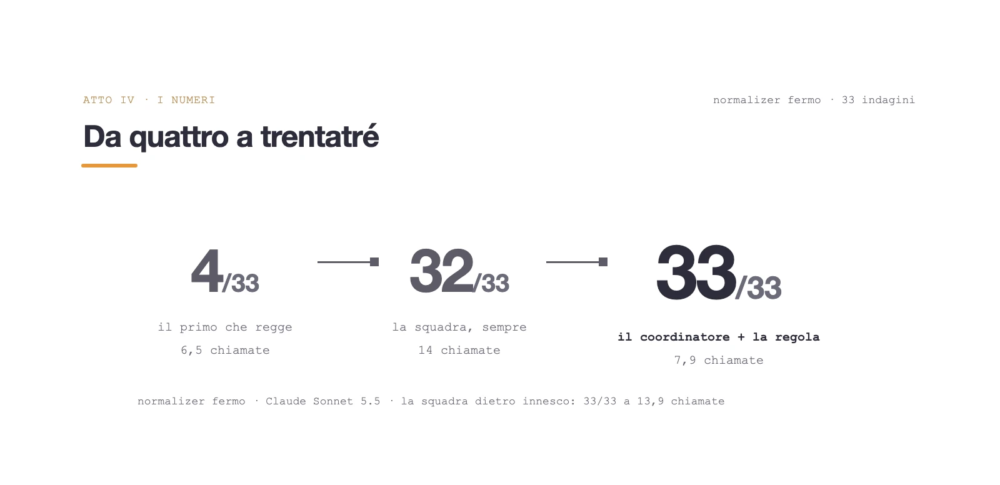

## Tre decisioni tolte al modello, tre che restano

Rimesso insieme, il sistema toglie al modello tre decisioni:

| Decisione | Chi la prende |
|---|---|
| Scrivere la query | il codice la compone dai parametri scelti |
| Inventare un nome | l'elenco viene dai backend, a ogni domanda |
| Chiudere troppo presto | un router di `if` sui fatti, poi la soglia |

E ne lascia tre, ed è lì che stanno gli errori che ho misurato: sceglie l'agente, e può mandare la domanda nel posto sbagliato; pesa le ipotesi, e la sua confidence non separa le risposte giuste dalle sbagliate; confronta prove di fonti diverse, e senza un fatto scritto che le separi paga il doppio per trovare la causa, o non la trova.

Ogni passo che ha funzionato ha tolto una libertà al modello. Il primo da fare su un sistema proprio è chiedersi, per ogni decisione dell'agente, chi scrive la sintassi e chi decide quando basta: dove esiste un fatto che può decidere al posto del modello, quel fatto va nel codice. È lo stesso principio che applico ai test scritti dagli agenti, dove a decidere se funzionano è il [mutation testing](/blog/verificare/testing/chiudere-il-loop-mutation-testing/).

Togliere decisioni al modello ha reso il sistema più preciso e più economico insieme: sul guasto difficile la regola scritta nel codice trova la causa 33 volte su 33 a 7,9 chiamate al modello per indagine, la squadra di agenti chiamata sempre 32 volte su 33 a 14.
