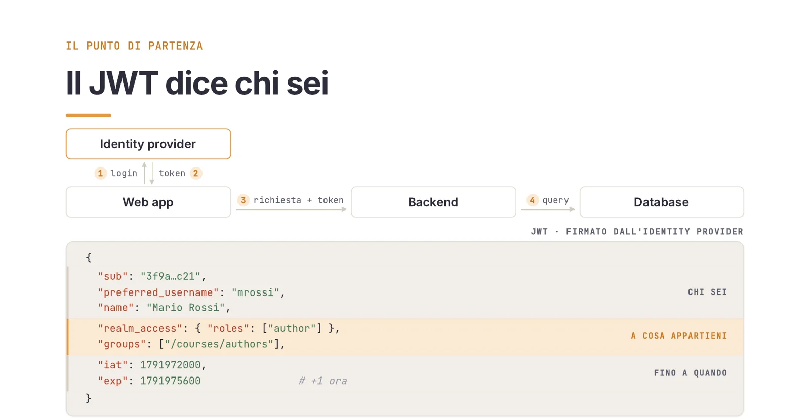
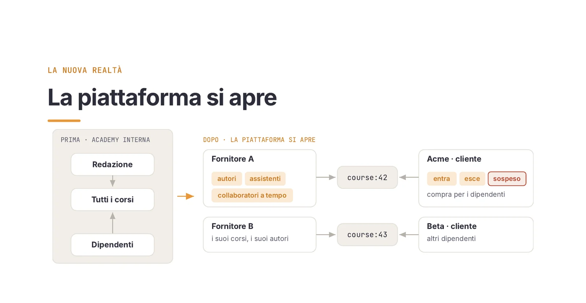
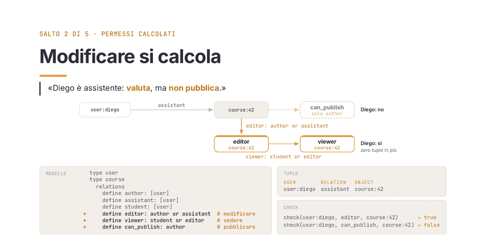
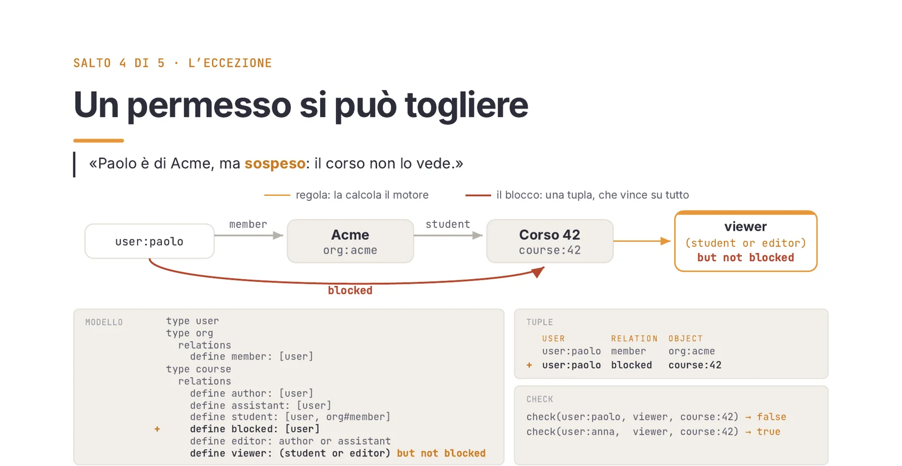
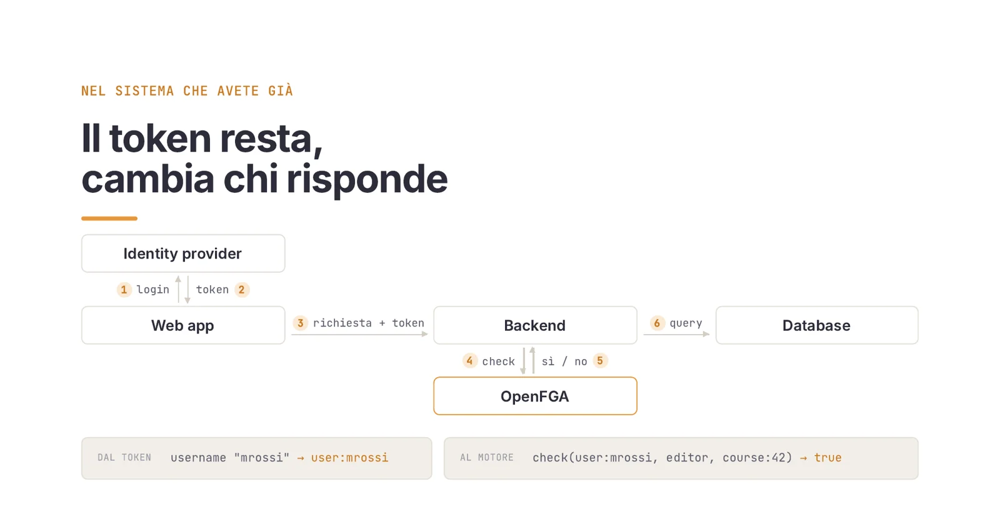
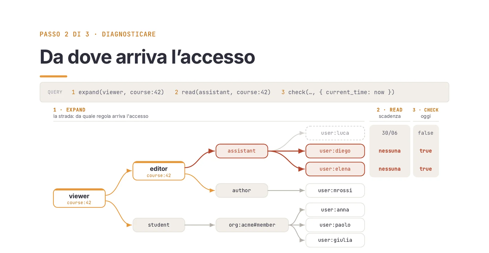
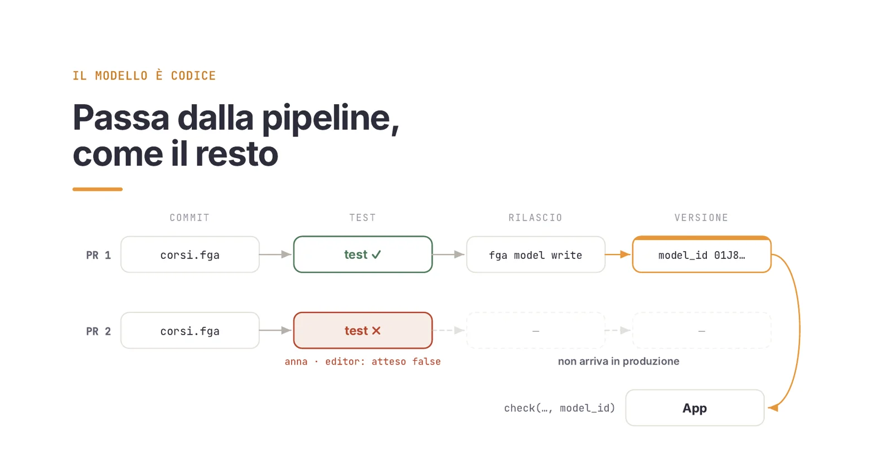
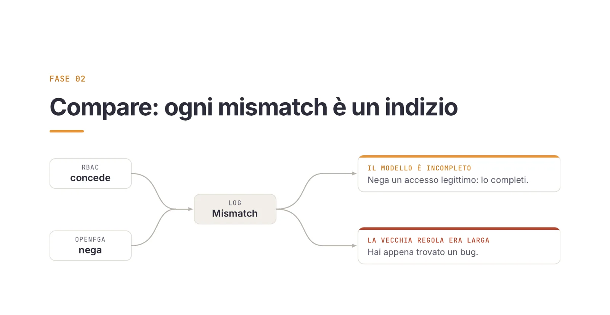
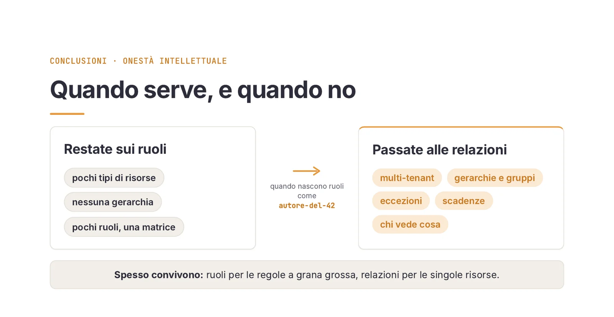

Venerdì pomeriggio chiama un fornitore. Un suo collaboratore doveva restare sul progetto fino a giugno, e invece apre ancora i corsi e ci lavora sopra. Che si fa?

Passata la prima reazione, ci si aprono davanti moltissime domande: Chi altro è esposto, adesso, senza che nessuno l'abbia segnalato? Da dove arriva quell'accesso? Da quando c'è, e perché non è mai sparito?

Se l'autorizzazione vive nei ruoli dentro il JWT, nessuna delle tre ha una risposta che non sia un'indagine a mano: database, configurazione dell'identity provider, codice dei controller, e la memoria di chi ha assegnato cosa. Con un modello a relazioni, invece, ognuna delle tre è una chiamata API. Lo scenario viene dal mio [talk al DevSecOps Day 2026](/talks/oltre-i-ruoli-openfga/) di Bologna,  potete trovare le slide [qui](/files/talk-openfga-devsecopsday-2026.pdf).

## Tre ruoli bastano, finché la piattaforma resta chiusa

Come esempio prendiamo un caso tutto sommato semplice: una piattaforma interna di corsi aziendali con pochi tipi di utenti. Gli amministratori gestiscono la piattaforma, gli autori scrivono i corsi e valutano gli studenti, gli studenti (cioè ogni dipendente) seguono qualunque corso.

Tre ruoli bastano davvero, e il ruolo è una scorciatoia con buone ragioni dalla sua parte:

- si capisce subito: una parola, e tutti sanno di cosa si parla;
- c'è ovunque: l'identity provider lo mette nel token, il framework lo controlla con un attributo;
- costa poco: è già nel token, e il backend ha tutto quello che gli serve per decidere.

Il token di Mario, autore, contiene chi è (`sub`, `preferred_username`), a cosa appartiene (`realm_access.roles: ["author"]`, i gruppi) e fino a quando vale (`iat`, `exp`). È firmato, quindi nessuno può modificarlo e ogni servizio lo verifica da solo con la chiave pubblica. 

> **Per approfondire**: come Keycloak e OpenFGA si dividono identità e permessi è nel [secondo articolo della serie](/blog/verificare/openfga/02-openfga-keycloak/).



Quello che nel token non c'è è cosa Mario può fare. C'è un'etichetta, che viene usata dal backend per tradurre quella informazione in un permesso.

Poi la piattaforma ha successo e si apre. Da una parte arrivano i fornitori, ognuno con i suoi corsi, i suoi autori, assistenti che non possono fare tutto quello che fa un autore, collaboratori a tempo. Dall'altra arrivano i clienti, aziende che comprano corsi per i propri dipendenti, e quei dipendenti entrano, escono, vengono sospesi.

> **Per approfondire**: l'isolamento fra un tenant e l'altro ha un [articolo dedicato](/blog/verificare/openfga/03-multitenancy/).



A quel punto un ruolo non sa più dire tre cose:

1. **Autore di cosa?** Mario è autore del suo corso, e su quello di un altro fornitore è solo studente. `author` non li distingue.
2. **E un'eccezione?** Paolo, dipendente di Acme, viene sospeso per un mese, ma resta in Acme.
3. **Fino a quando?** Luca serve come assistente fino al 30 giugno.

Con i ruoli la risposta è sempre la stessa: si assegna, e poi qualcuno deve ricordarsi di togliere. E anche quando se ne ricorda, il ruolo vive nel token emesso, che il backend valida da solo fino a `exp`. Le durate di default dell'access token vanno dai 5 minuti di Keycloak ai 60-90 di Entra ID, fino alle 24 ore di Auth0 per le API custom. Per tutto quel tempo il permesso revocato è ancora lì.

## Ogni permesso nasce da un legame

Le tre domande hanno la stessa origine: il ruolo è un'etichetta attaccata alla persona. Dice chi sei, e lì si ferma: l'oggetto e la scadenza restano fuori.

Ribaltando la prospettiva, la domanda diventa quale relazione ha una persona con una risorsa del sistema. Le tre frasi di prima si riscrivono così:

- Mario *ha scritto* il corso 42, quindi lo può modificare.
- Paolo *è sospeso dal* corso 42, quindi non lo può vedere.
- Luca *corregge* il corso 42 fino al 30 giugno, quindi dal primo luglio niente.

Ogni frase ha tre pezzi: una persona, un legame, un oggetto. Nessuna etichetta sulla persona.

Il modello viene da Zanzibar, il sistema con cui Google autorizza Drive e YouTube, descritto in un paper del 2019. OpenFGA ne è l'implementazione open source, progetto CNCF dal 2022. Tupla, modello e check sono spiegati in [Zanzibar per tutti](/blog/verificare/openfga/01-zanzibar-concetti/): qui bastano cinque concetti.

### Una relazione vive su un oggetto

La tupla `user:mrossi author course:42` è un fatto e si legge come una frase. Il check `check(user:mrossi, author, course:42)` risponde `true`, sul corso 43 risponde `false`, perché lì Mario è `student`.

### Un permesso si calcola

Diego è assistente del corso 42: valuta, ma non pubblica. Il modello definisce come si calcolano i permessi. `editor` è `author or assistant`, `viewer` è `student or editor`, `can_publish` è solo `author`. Con una sola tupla, `user:diego assistant course:42`, il motore risponde sì a `editor` e a `viewer`, e no a `can_publish`.



### Un legame vale per un gruppo

Acme compra il corso 42 per tutti i suoi dipendenti, anche per chi arriva domani. Introduco un tipo `org` con la relazione `member`, e dico che uno studente del corso può essere anche `org#member`, i membri di un'organizzazione. La tupla `org:acme#member student course:42` è una sola. Quando Acme assume Giulia scrivo una riga, `user:giulia member org:acme`, e Giulia vede il corso. I corsi non li tocco più: l'espansione del gruppo avviene al momento del check.

### Un permesso si può togliere

Paolo è di Acme, ma sospeso. Aggiungo una relazione `blocked` e la uso nella regola: `viewer` diventa `(student or editor) but not blocked`. Una tupla, `user:paolo blocked course:42`, e Paolo non vede il corso per nessuna strada da cui ci arrivi. Anna, stessa azienda e stesso gruppo, lo vede ancora. Non ho smontato niente di quello che già c'era.



### Un permesso scade da solo

Le tuple possono portarsi dietro dei parametri. Quella di Luca dice che è assistente del 42 con `valid_until: 2026-06-30T23:59:59Z`, e il modello definisce una condizione `non_expired` che confronta quella data con l'ora corrente, passata dall'applicazione a ogni chiamata. Il check del 15 giugno risponde `true`, quello del 2 luglio `false`, sulla stessa tupla: nessuno l'ha toccata, e non serve un cron che la tolga.

### Il modello completo

I cinque concetti insieme:

```plaintext
# corsi.fga
model
  schema 1.1

type user

type org
  relations
    define member: [user]

type course
  relations
    define author: [user]
    define assistant: [user, user with non_expired]
    define student: [user, org#member]
    define blocked: [user]
    define editor: author or assistant
    define viewer: (student or editor) but not blocked
    define can_publish: author

condition non_expired(current_time: timestamp, valid_until: timestamp) {
  current_time < valid_until
}
```

Il modello è un file e sta in git. La riga di `assistant` accetta sia un utente semplice sia un utente con scadenza: è quella che la correzione, più avanti, cambia.

## Il token resta, cambia chi decide

Nel sistema che c'è già, login, token e richiesta restano uguali. Cambia il backend: invece di decidere dal ruolo, prende l'identità dal JWT (`mrossi` diventa `user:mrossi`) e chiede al motore se Mario è `editor` del corso 42. Se la risposta è sì si va al database, se è no ci si ferma.



Il JWT dice chi sei, il motore dice cosa puoi fare adesso, a ogni richiesta, come chiede Zero Trust per l'autorizzazione. E la revoca diventa una riga cancellata: il check successivo risponde no, senza aspettare che scada un token e senza logout forzato.

La revoca è immediata finché la cache dei check resta spenta, come da default in OpenFGA. Se la accendete il TTL di default è di 10 secondi, e per le operazioni sensibili si chiede `HIGHER_CONSISTENCY` sul singolo check.

## Chi, da dove, da quando: tre passi

Torniamo al venerdì pomeriggio. Qui il modello a relazioni restituisce più di un sì o di un no, perché i permessi sono dati che si possono interrogare.

### Chi può vederlo, adesso

La domanda utile riguarda tutto il corso, oltre al collaboratore segnalato. È una chiamata sola, che per default restituisce fino a 1.000 utenti:

```plaintext
listUsers(viewer, course:42, context: { current_time: now })
```

Risponde con cinque utenti. OpenFGA dice chi *può* accedere. Se sia giusto lo stabilisce il confronto con chi sa chi è chi: l'anagrafica del cliente, lo staff, l'HR. Anna e Giulia sono dipendenti di Acme, Mario è l'autore, e tornano. Paolo non compare: è dipendente di Acme, ma la tupla `blocked` lo esclude. Diego è il collaboratore della segnalazione. Elena, assistente anche lei, è uscita a maggio e non l'aveva segnalata nessuno. Cinque nomi, due di troppo, e la segnalazione ne conteneva uno.

Luca non c'è: la sua scadenza è passata ed è uscito da solo. Perché succeda, `ListUsers` deve ricevere l'ora corrente nel contesto, come ogni check. Senza, la richiesta fallisce: OpenFGA non può valutare la scadenza e lo dice con un errore, invece di indovinare.

### Da dove arriva l'accesso

Servono tre chiamate, ognuna con un compito:

1. `expand` restituisce l'albero delle regole un livello alla volta: `viewer` è `student` o `editor`, meno `blocked`; `editor` è `author` o `assistant`. Espandendo `assistant` compaiono Luca, Diego ed Elena, espandendo `student` si arriva a `org:acme#member`. Luca compare anche se è scaduto, perché expand mostra la struttura e non valuta le condizioni.
2. `read(assistant, course:42)` restituisce le tuple così come sono state scritte. Quella di Luca ha `valid_until` al 30 giugno, quelle di Diego ed Elena nessuna condizione.
3. Il check di oggi conferma: Luca no, Diego ed Elena sì.



Il problema è un modo di dare accesso: due assistenti con la stessa relazione di Luca, ma senza scadenza. E siccome `assistant` implica `editor`, potevano anche modificare.

### Da quando

OpenFGA tiene un registro delle modifiche alle tuple, e `readChanges` lo restituisce in ordine, con data e operazione. Si filtra per tipo di oggetto, quindi qui sono le righe di `course` ristrette al corso 42:

```plaintext
OPERATION  TIMESTAMP   TUPLE_KEY                        CONDITION
WRITE      2026-02-09  user:diego assistant course:42   nessuna
WRITE      2026-02-09  user:elena assistant course:42   nessuna
WRITE      2026-04-02  user:luca  assistant course:42   non_expired · 30/06
```

Il 9 febbraio Diego ed Elena diventano assistenti senza scadenza. Ad aprile entra Luca, e lui la scadenza ce l'ha. Il 30 giugno il progetto finisce e nel registro non succede niente: nessun `DELETE`. Con la scadenza, come per Luca, si sarebbe chiuso da solo.

### Chiudere, e dimostrarlo

Si chiude con un `delete` per ciascuno, e si verifica: `check(user:diego, viewer, course:42)` risponde `false`, lo stesso per Elena. L'effetto è alla richiesta successiva.

Chi, da dove, da quando, e la prova che l'accesso è chiuso: è quello che chiede un audit. Con un modello a relazioni sono poche chiamate, ripetibili, il cui output si allega come evidenza.

## Una riga nel modello, e l'errore non torna

Il delete ha chiuso il caso di Diego ed Elena. Il prossimo collaboratore, però, entrerebbe nello stesso modo, perché il modello accettava un assistente senza scadenza.

La correzione è una riga, in una pull request:

```diff
 type course
   relations
-    define assistant: [user, user with non_expired]
+    define assistant: [user with non_expired]
```

Da quel momento `write(user:sara, assistant, course:42)` senza condizione viene rifiutata dal motore, perché ogni scrittura è validata contro il modello. Con `non_expired { valid_until: 2026-12-31T23:59:59Z }` passa. L'errore di febbraio non si può più ripetere.

I modelli in OpenFGA sono immutabili, e le tuple non valide per il modello in uso vengono ignorate quando si valutano le query. Prima di pubblicare la nuova versione, gli assistenti già scritti senza data vanno riscritti con una scadenza. Altrimenti perdono l'accesso in silenzio.

Resta da evitare che lo stesso errore rientri con una PR futura. Il modello è un file, `corsi.fga`, e i permessi stanno tutti lì: per questo può entrare nella pipeline come il resto del codice.

- In CI gira `fga model test`, con asserzioni sui permessi: Anna deve vedere il corso e non deve poterlo modificare.
- Se una PR cambia una regola e Anna, senza che nessuno se ne accorga, diventa `editor`, il test fallisce e la modifica non arriva in produzione.
- Se i test passano, `fga model write` pubblica il modello e ne restituisce il `model_id`.
- L'applicazione passa il `model_id` a ogni check, quindi sa sempre con quale versione ragiona. Il rollback consiste nel tornare all'id precedente.



## Quattro fasi per endpoint, con un criterio misurabile per passare

Tutto questo vale su un sistema nuovo. Ma un sistema a ruoli in produzione c'è già, ed è testato, conosciuto, e nessuno vuole toccarlo. Chi ha paura del cambio ha le sue ragioni: il vecchio ha già superato tutti i casi che conosciamo, il nuovo no.

Per questo la migrazione non chiede di fidarsi del modello nuovo. Chiede di guardare le prove, e ogni fase ne produce una mentre il sistema continua a girare. Le fasi sono quattro, applicate un endpoint alla volta:

1. **Backfill.** Il primo giorno il motore non sa niente. Si importa lo stato esistente (ruoli, proprietà, iscrizioni) come tuple, una volta sola. Da lì in poi ogni permesso nuovo si scrive sia nel database sia in OpenFGA. Senza backfill, la fase successiva darebbe falsi allarmi a ogni richiesta.
2. **Shadow.** A ogni richiesta il backend fa la stessa domanda due volte. Il vecchio controllo decide e risponde all'utente. OpenFGA risponde in asincrono, con un timeout, e la sua risposta finisce in un log solo se diverge. Se OpenFGA sbaglia, se ne accorge solo il team.
3. **Compare.** Il caso tipico è il vecchio controllo che concede e OpenFGA che nega. Le spiegazioni possibili sono due. O il modello è incompleto e manca un accesso legittimo, e allora lo si completa. Oppure la vecchia regola era troppo larga, e si è appena trovato un bug di autorizzazione in produzione prima di qualcun altro. Il caso opposto, il vecchio che nega e OpenFGA che concede, è quello pericoloso: modello troppo largo o backfill sbagliato. Blocca il passaggio finché non è spiegato.
4. **Cutover.** Stesso schema con le parti scambiate: adesso all'utente risponde OpenFGA, che ha già risposto per settimane in ombra. Si gira un flag, e se qualcosa va storto lo si rigira.



Il passaggio dal compare al cutover è un release gate: mismatch non spiegati a zero per un certo numero di giorni, su una versione precisa del modello, un numero che chiunque può ricontrollare. Va deciso prima chi legge i mismatch e chi firma il passaggio.

Da dove partire? Dall'endpoint che fa più male, quello dove sono nati i ruoli come `autore-del-42`. Se il team è nuovo al modello, dal più semplice.

## Il segnale è un ruolo con un id nel nome

Passare alle relazioni non conviene sempre. Con pochi tipi di risorse, nessuna gerarchia e pochi ruoli che stanno in una matrice, OpenFGA aggiunge un motore, un modello e un database di tuple da mantenere senza risolvere un problema che non c'è. Conviene con più tenant, gerarchie e gruppi, eccezioni, scadenze, e quando qualcuno chiede chi vede cosa.



Il segnale per passare si conta: i ruoli con un identificativo nel nome, come `autore-del-42`. Lì il ruolo ha smesso di fare il ruolo e sta descrivendo una relazione con un oggetto preciso. E spesso i due modelli convivono: ruoli per le regole a grana grossa (amministrazione, fatturazione), relazioni per le singole risorse.

Una domanda che arriva sempre riguarda OPA e Cedar. Rispondono a un'altra domanda: valutano regole su attributi e contesto, come in [Keycloak con OPA](/blog/progettare/keycloak/05-keycloak-opa/), mentre OpenFGA ragiona su chi è autore di cosa e chi è membro di cosa. Spesso convivono anche loro.

Quando il modello cresce arrivano le gerarchie profonde e la domanda inversa, cioè tutto quello che un utente può vedere. Ne parlano due articoli della serie: [gerarchie e query inverse](/blog/verificare/openfga/04-gerarchie-query/) e [ListObjects in produzione](/blog/verificare/openfga/05-listobjects-performance/).

Il primo passo concreto sta in una settimana. Scrivete tre frasi come quelle di Mario, Paolo e Luca, tiratene fuori tipi, legami e regole, e provatele nel Playground di OpenFGA. Poi un test del modello in CI, e uno shadow accanto al controllo che già c'è, sull'endpoint che fa più male. Dopo due settimane avete un log dei mismatch, e ogni regola vecchia troppo larga che contiene è un bug di autorizzazione in produzione.

La revisione periodica dei diritti di accesso la chiedono le norme: la [direttiva NIS2](https://eur-lex.europa.eu/eli/dir/2022/2555/oj) (in Italia il D.Lgs. 138/2024) mette le politiche di controllo degli accessi fra le misure obbligatorie dell'articolo 21, e la ISO/IEC 27001:2022 chiede, nel controllo A.5.18, di riesaminare i diritti di accesso a intervalli regolari. Con i ruoli quella revisione è un foglio compilato a mano; con le relazioni diventa una chiamata ripetibile, con la storia delle modifiche e ogni cambio di regola in una pull request.
