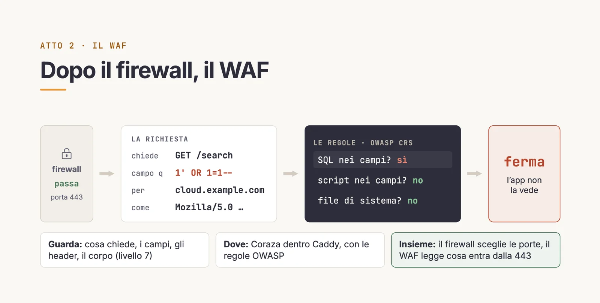
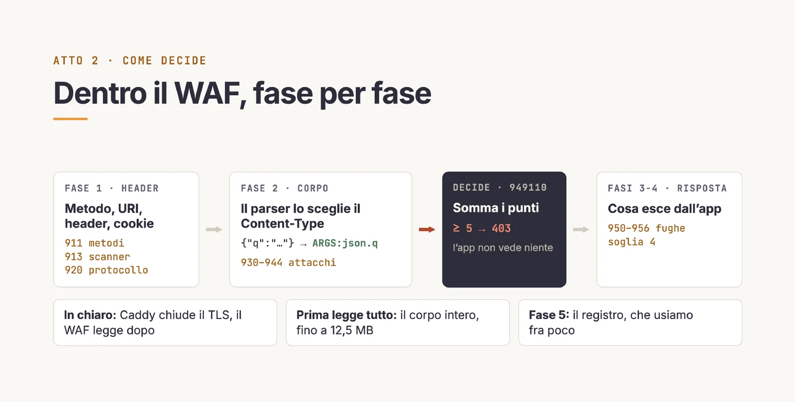
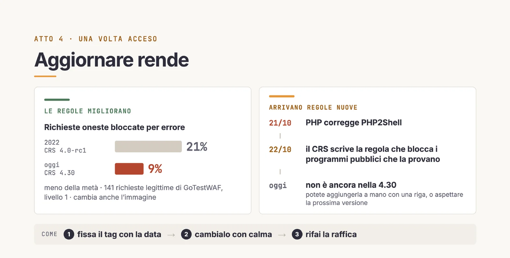
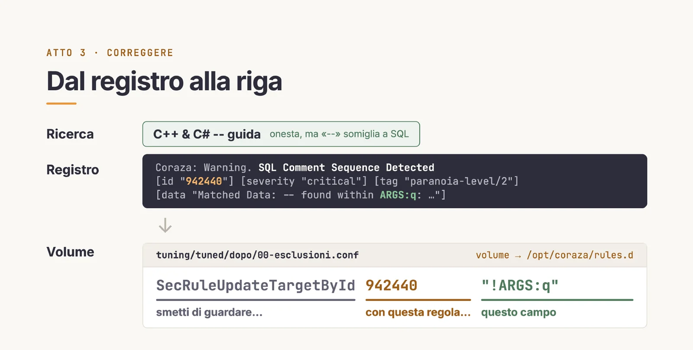
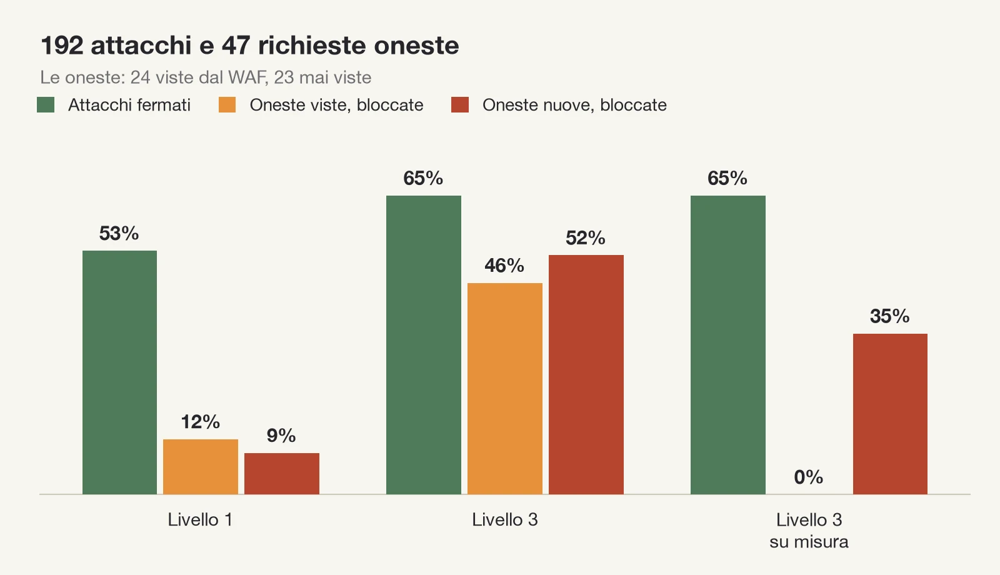
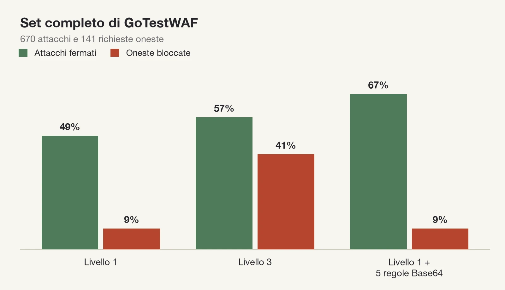
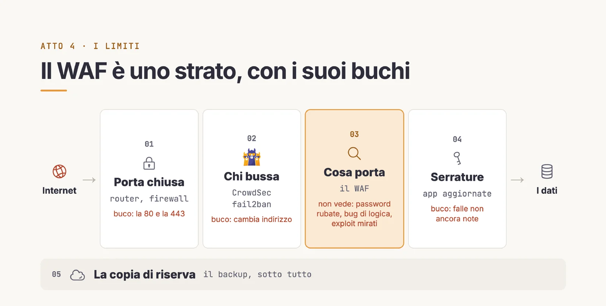

Chi espone un servizio da casa, [Nextcloud](https://nextcloud.com), [Gitea](https://about.gitea.com), [Home Assistant](https://www.home-assistant.io), ha chiuso le porte che poteva chiudere: SSH, il database, il pannello di Docker. Ma se vogliamo accedere ai nostri alcune porte devono inevitabimente rimanere aperte, basti pensare a casi come la porta 80 oppure 443 per il traffico web. Un firewall guarda da quale indirizzo arriva una richiesta e a quale porta bussa, non il contenuto della richiesta stessa.

Ma cosa potrebbe nascondersi di insolito dentro una richiesta? Prendiamo ad esempio un semplice applicativo che si occupa d servire una campo che permette di interrogare un database. Un utente potrebbe fare una richiesta legittima come «tastiera meccanica» oppure qualcosa di ben più strano come  `1' OR 1=1--`. Una ricerca di questo tipo è in realtà un tentativo di SQL injection. Il firewall vede una richiesta sulla porta 443 da un indirizzo qualunque, e la lascia passare.

Al [Linux Day Prato 2026](/talks/waf-open-source-coraza-caddy/) ho mostrato come mettere davanti ai propri servizi un WAF, un Web Application Firewall, fatto solo di software libero, e cosa succede quando lo si misura con uno scanner automatico. Le [slide](/files/talk-waf-linux-day-prato-2026.pdf) sono pubbliche.

## I bot provano ogni indirizzo che risponde

Non è detto che l'entità che prova a portar eun attacco di questo genere sia un essere umano, secondo il [Bad Bot Report 2026 di Thales (Imperva)](https://cpl.thalesgroup.com/sites/default/files/content/campaigns/badbot/2026-thales-bad-bot-report.pdf), nel 2025 il traffico automatico era il 53% del traffico web osservato, e i bot malevoli il 40%, contro il 37% dell'anno prima.

Thales scrive anche che gli attacchi dei bot guidati dall'AI sono [cresciuti di 12,5 volte](https://cpl.thalesgroup.com/about-us/newsroom/ai-driven-bot-attacks-surged-according-to-bad-bot-report) rispetto all'anno precedente.

Script lanciati a strascico ci sono sempre stati. Nell'agosto 2025 Anthropic ha [scritto](https://www.anthropic.com/news/detecting-countering-misuse-aug-2025) che l'AI ha abbassato le barriere al cybercrimine sofisticato, e nel settembre 2026 Google ha [descritto](https://cloud.google.com/blog/topics/threat-intelligence/from-prompting-to-autonomy-the-evolution-of-adversarial-ai) una campagna di massa per il furto di credenziali pianificata, costruita ed eseguita con l'AI in meno di sei ore.

Nel frattempo gli stessi servizi sono diventati container, ognuno nella sua scatola, tutti dietro un reverse proxy, il programma che riceve le richieste da internet e le passa all'app giusta. Una porta sola, tanti servizi. Il reverse proxy consegna la richiesta senza leggerla, e cosa succede dopo dipende solo da come è scritta l'app.

> **Per approfondire**: cosa c'è dentro un container, namespace e cgroup, è nell'[articolo su Docker](/blog/automatizzare/docker/docker-internals/).

Non serve essere imbattibili. Christian Folini, del progetto OWASP Core Rule Set, [scriveva nel 2019](https://www.bcs.org/content-hub/buying-time-against-attack/) che chi attacca di solito rinuncia e cerca una preda più facile, soprattutto se le regole sono strette e ben configurate. Il WAF serve a non essere la preda più facile.

## Cosa fa un WAF in più del reverse proxy

Un WAF sta fra internet e l'app, come il reverse proxy, ma a differenza del proxy legge il contenuto: il percorso, i parametri, i campi dei moduli, gli header. Per ogni richiesta fa una di tre cose: la lascia passare, la annota in un registro, oppure la ferma con un 403, il codice HTTP che vuol dire «vietato». Una richiesta fermata l'app non la vede mai.



Lo stack che ho usato ha tre componenti, tutti con licenza Apache 2.0:

- **[Caddy](https://caddyserver.com)** è il reverse proxy, e fa anche HTTPS da solo, con i certificati Let's Encrypt.
- **[Coraza](https://owasp.org/www-project-coraza-web-application-firewall/)** è il WAF. È un progetto OWASP, scritto in Go, e dentro Caddy gira come [plugin](https://github.com/corazawaf/coraza-caddy).
- **Il [Core Rule Set](https://github.com/coreruleset/coreruleset)** (CRS) di OWASP sono le regole che Coraza applica, scritte da una comunità dal 2009: centinaia di descrizioni di come sono fatti gli attacchi comuni.

Il team del CRS pubblica [un'immagine](https://github.com/coreruleset/coraza-crs-docker) con dentro tutti e tre, `ghcr.io/coreruleset/coraza-crs`, per amd64 e arm64. Quella che ho misurato ha Caddy 2.11.4 e CRS 4.30.0. Niente da compilare.

## Un container in più e un blocco nel Caddyfile

Nel `docker-compose.yml` il WAF prende il posto del reverse proxy:

```yaml
services:
  caddy:
    # tag con la data della build: quello che ho misurato. Per uno più recente
    # cerca un tag <versione CRS>-caddy-alpine-<data> nella pagina dell'immagine
    image: ghcr.io/coreruleset/coraza-crs:4.30.0-caddy-alpine-202610110510
    ports:
      - "80:80"
      - "443:443"
    environment:
      CORAZA_RULE_ENGINE: DetectionOnly
      BLOCKING_PARANOIA: 1
    volumes:
      - ./Caddyfile:/config/caddy/Caddyfile:ro
      - ./tuning:/opt/coraza/rules.d:ro
      - caddy_data:/data

volumes:
  caddy_data:
```

Le parti che si toccano, dell'immagine e del compose (le [variabili d'ambiente](https://github.com/coreruleset/coraza-crs-docker#env-variables) sono nella documentazione dell'immagine):

| Voce | Cosa fa | Valori |
|---|---|---|
| `CORAZA_RULE_ENGINE` | l'interruttore | `DetectionOnly` annota e lascia passare, `On` blocca, `Off` spegne |
| `BLOCKING_PARANOIA` | la severità: quante regole accendere | da 1 a 4 |
| `./tuning` | le correzioni, l'unica parte del WAF che si scrive a mano | file `.conf` in SecLang |
| `caddy_data` | i certificati, tenuti fra un riavvio e l'altro | volume |
| porta 80 | serve a Caddy per ottenere i certificati e per rimandare a HTTPS | |

I servizi da proteggere stanno nella stessa rete del compose.

Nel Caddyfile il WAF è un blocco riusabile, che ogni servizio importa:

```
{
	order coraza_waf first
}

(waf) {
	coraza_waf {
		directives `
			Include /opt/coraza/config/coraza.conf
			Include /opt/coraza/config/crs-setup.conf
			Include /opt/coraza/owasp-crs/rules/*.conf
			Include /opt/coraza/rules.d/*.conf
		`
	}
}

cloud.example.com {
	import waf
	reverse_proxy nextcloud:80
}
```

`cloud.example.com` e `nextcloud` sono segnaposto per il vostro dominio e il vostro container.

Fra i backtick c'è configurazione SecLang, la lingua delle regole del CRS, che Caddy passa a Coraza così com'è.

Una riga è obbligatoria: [`order coraza_waf first`](https://caddyserver.com/docs/caddyfile/directives#directive-order). `coraza_waf` arriva da un plugin, e Caddy non sa in che punto della catena metterlo: senza quella riga si rifiuta di partire. `first` lo mette davanti a tutto, quindi la richiesta viene controllata prima di essere consegnata all'app.

Anche l'ordine degli `Include` è obbligato: le correzioni stanno dopo le regole perché le nominano, e un'esclusione su una regola non ancora definita fa fallire l'avvio.

Aggiungere un servizio protetto, a quel punto, costa sei righe: due nel compose (il nome e l'immagine, nessuna porta pubblicata, quindi da fuori il container non si vede) e quattro nel Caddyfile (l'indirizzo, `import waf`, `reverse_proxy` verso il container, la graffa che chiude). Il router di casa non si tocca.

## Ogni regola che scatta aggiunge punti

Le regole del CRS non bloccano una per una. Ogni regola che riconosce qualcosa aggiunge punti alla richiesta, secondo la sua gravità: 5 se è critica, 4 se è un errore, 3 un avvertimento, 2 una nota. Quando la somma arriva alla soglia, 5 di default, la richiesta si ferma. Una regola, però, scatta solo se il livello di severità scelto comprende il suo: molte regole sul doppio trattino o sui simboli sono del livello 2 o 3, e al livello 1 restano spente.



Con tre richieste allo stesso campo di ricerca:

| Richiesta | Punti | Esito |
|---|---|---|
| `tastiera meccanica` | 0 | passa |
| tanti simboli di fila, `+ & # -- !!` | 3 | passa |
| `1' OR 1=1--` | 5 | fermata |

Basta una regola critica per fermare una richiesta, mentre un sospetto lieve da solo non basta. Un attacco che ne accende più di una supera la soglia con margine. Nella demo, uno script dentro un campo di ricerca (XSS) lo riconoscono quattro regole diverse.

Il modo prudente di accenderlo su un servizio che già gira è `DetectionOnly`. Stessa richiesta, stesso 200, ma nel registro del WAF c'è scritto che una SQL injection è stata riconosciuta e che, in modalità blocco, l'avrebbe fermata. Cambiando l'interruttore in `On`, nella demo, dodici richieste in un secondo danno questo: le quattro oneste passano, gli otto attacchi ricevono 403.

## Quanto ferma, misurato con uno scanner

Un WAF che ferma la mia SQL injection di esempio non dice molto, quindi l'ho misurato con due scanner automatici. Davanti al WAF c'era un backend finto che risponde «ok» a qualunque richiesta: si conta solo quante richieste lo raggiungono.

### GoTestWAF: il 49% va scomposto

[GoTestWAF](https://github.com/wallarm/gotestwaf), di Wallarm, manda circa 670 attacchi noti e 141 richieste legittime costruite apposta per sembrare sospette. Con la configurazione di serie, il livello 1:

- degli attacchi diretti, come li manda un bot, ne ferma 146 su 159, il 92%;
- di tutti i 670 attacchi ne ferma il 49%;
- delle 141 richieste oneste ne blocca per errore il 9%.

Il 49%, da solo, suona come «funziona a metà», ma va scomposto. GoTestWAF manda ogni attacco in più forme: in chiaro, codificato per l'URL, codificato in Base64. Le varianti in Base64 sono 233 su 670, e il WAF di serie non le decodifica: le lascia passare tutte. Senza quelle varianti, cioè guardando gli attacchi come li legge qualunque app, il WAF ne ferma il 75%. Le varianti in Base64 riguardano solo le app che decodificano da sole il Base64 che ricevono.

### Nuclei: due conteggi dello stesso scanner

Il secondo scanner è [Nuclei](https://github.com/projectdiscovery/nuclei), di ProjectDiscovery, lo stesso che usano anche i bot veri. La stessa scansione si può contare in due modi:

- **Tutte le richieste.** Senza WAF arrivano al backend circa 19.100 richieste, con il livello 1 ne arrivano 12.682: una su tre si ferma prima. Il resto comprende molte sonde che chiedono soltanto se un prodotto esiste, per esempio `GET /adminer-4.7.3.php`: non portano niente, e un WAF fa bene a lasciarle passare.
- **Solo gli attacchi veri.** Rifatta il 23 ottobre contando solo le richieste con un parametro che ha un valore o con un corpo, la misura dice che il livello 1 ne ferma 2.535 su 2.956, l'86%, e il livello 3 il 90%: i numeri mostrati nel talk.

I due conteggi non si contraddicono: il primo misura quanto traffico il WAF toglie, il secondo quanti attacchi ferma.


### Quanto pesano i numeri, e quanto pesa l'aggiornamento

Questi numeri vanno letti con due limiti:

- GoTestWAF viene da Wallarm, un'azienda che vende un WAF, e il suo set è costruito per mettere in difficoltà i WAF: il 9% di richieste oneste bloccate sovrastima gli errori su un servizio reale;
- ho misurato ogni profilo una volta sola, in laboratorio, senza ripetizioni.

La prima versione della demo usava un'immagine ferma al 2022, con CRS 4.0.0-rc1. Passando all'immagine del team CRS, gli attacchi fermati salgono dal 40% al 49% e le richieste oneste bloccate scendono dal 21% al 9%. Nel passaggio CRS, Coraza e Caddy cambiano tutti e tre, quindi il miglioramento va attribuito all'immagine nel suo insieme.



## Più severo vuol dire molti più errori

La reazione naturale al 49% è alzare la severità. Al livello 3 il WAF accende molte più regole, e la misura dice quanto costa: gli attacchi fermati salgono dal 49% al 57%, le richieste oneste bloccate dal 9% al 41%: otto punti di copertura in più costano trentadue punti di errori.

Un esempio dalla demo. Al livello 3 cerco un libro: «C++ & C# -- guida». La richiesta riceve 403. Il doppio trattino somiglia all'inizio di un commento nel linguaggio dei database, e tutti quei simboli di fila sembrano un tentativo di confondere il parser. Per una libreria tecnica è una ricerca normale.

La correzione si legge nel registro. Il WAF dice quale regola ha fermato la richiesta e dove ha trovato il sospetto:

```
Warning. SQL Comment Sequence Detected
[id "942440"] [severity "critical"] [tag "paranoia-level/2"]
[data "Matched Data: -- found within ARGS:q: …"]
```

Da lì la riga che va nella cartella `tuning`:

```
SecRuleUpdateTargetById 942440 "!ARGS:q"
SecRuleUpdateTargetById 942460 "!ARGS:q"
```

Si legge così: con questa regola, smetti di guardare questo campo. Due regole, la 942440 per il doppio trattino e la 942460 per i simboli, non guardano più il campo di ricerca `q`. Ovunque altro restano accese, e la SQL injection nel campo `q` resta bloccata, perché la prende un'altra regola. Togliere un campo a una regola costa molto meno copertura che spegnere la regola ovunque.



## Correggere su misura, e misurare la correzione

### Il giro di correzione

Una correzione fatta su un esempio va verificata. La documentazione del CRS descrive un giro di correzione, e l'ho rifatto con i file di configurazione della demo e le richieste di GoTestWAF, tutte nel campo `q`, come se le scrivesse un utente:

1. **Guarda.** Livello 3, con la soglia a 10000: il WAF annota tutto e non blocca niente.
2. **Annota.** Il registro dice quali regole scattano sulle richieste oneste.
3. **Escludi.** Per ogni regola, un'esclusione su quel campo. Le regole da escludere risultano 12, tutte della famiglia SQL injection.
4. **Blocca.** Soglia di nuovo a 5, e si misura.

Le richieste sono quelle di GoTestWAF, senza i duplicati fra posizioni e codifiche: 192 attacchi e 47 richieste oneste, invece dei 670 e 141 del set completo. Le 47 le ho divise in due metà, a righe alterne: 24 «viste», che il WAF ha usato per imparare, e 23 «nuove», che non ha mai visto.

| | Livello 1 | Livello 3 | Livello 3 su misura |
|---|---|---|---|
| Attacchi fermati | 53% | 65% | 65% |
| Oneste viste bloccate | 12% | 46% | **0%** |
| Oneste nuove bloccate | 9% | 52% | 35% |

Le esclusioni non costano attacchi: le altre regole sullo stesso campo continuano a lavorare. Sulle richieste viste gli errori spariscono. Su quelle nuove calano, dal 52% al 35%, ma restano sopra il livello 1. Per questo il giro va ripetuto: più traffico vero guarda, meglio funziona, e il traffico vero si ripete più di quello di GoTestWAF.



### Mirare sul Base64

L'altra strada è mirare. Il CRS decodifica il Base64 solo in tre regole su un tipo di attacco preciso, le iniezioni in Node.js. Ho scritto cinque regole che:

- decodificano solo i valori con la forma del Base64, almeno 12 caratteri del suo alfabeto e niente spazi;
- ci cercano SQL injection, XSS e le altre forme comuni, con gli stessi rilevatori del CRS.

Al livello 1 più queste cinque regole, le varianti in Base64 fermate passano da 0 al 53%, e gli attacchi fermati in totale dal 49% al 67%. Le richieste oneste bloccate restano al 9%.

Sullo stesso set completo di GoTestWAF, il livello 3 arrivava al 57% con il 41% di errori, e anche lui lasciava passare tutte le varianti in Base64. Le cinque regole arrivano al 67% con il 9%. Su questo banco, mirare rende più che alzare la severità, e il guadagno sta tutto in quel terzo di varianti codificate. Con un limite: le richieste oneste di GoTestWAF non contengono Base64, quindi su un servizio che riceve token o dati codificati quelle regole vanno rimisurate.



## Cosa il WAF non vede

- **Password rubate.** Chi entra con la vostra password, per il WAF, siete voi.
- **Bug nella logica dell'app.** La richiesta che sfrutta un controllo dimenticato sembra onesta.
- **Altre porte.** SSH, la VPN, il database esposto per sbaglio non passano dal reverse proxy.
- **Attacchi camuffati.** Con tutte le varianti codificate, soprattutto quelle in Base64, al livello 1 ne passa circa uno su due.

James Reason, in [un articolo del 2000](https://pmc.ncbi.nlm.nih.gov/articles/PMC1117770/) sugli errori in medicina, descriveva la sicurezza come fette di formaggio svizzero: ognuna ha dei buchi, e l'incidente passa solo quando i buchi si allineano. Un servizio di casa ha le sue fette:

- il router e il firewall, che tengono chiuse le porte;
- fail2ban o CrowdSec, che bloccano chi bussa troppo;
- il WAF, che legge cosa arriva;
- le app aggiornate, che chiudono le serrature;
- e sotto a tutto il backup.

Il WAF è una fetta. Aggiornare le app resta la prima.



## PHP2Shell: due regole in attesa dell'aggiornamento

Il 21 ottobre PHP ha corretto due falle, [CVE-2026-109618](https://github.com/php/php-src/security/advisories/GHSA-w8hw-w9fx-j79w) e [CVE-2026-109619](https://github.com/php/php-src/security/advisories/GHSA-6wmf-4rv5-p3rp), che permettono di eseguire codice sul server senza login, con CVSS 9.2. Riguardano ogni installazione PHP che serve pagine, e la cura è aggiornare: 8.5.12, 8.4.27, 8.3.36 o 8.2.35.

Ho aggiunto alla demo un servizio PHP, già corretto, e gli ho mandato richieste innocue con la forma descritta negli avvisi pubblici, senza nessun exploit. Il CRS 4.30, ai livelli 1 e 3, le lascia passare tutte, perché la forma, da sola, è quella di un caricamento normale.

[AWS ha pubblicato](https://aws.amazon.com/blogs/security/using-aws-waf-to-apply-mitigations-for-php2shell-rce-vulnerabilities-cve-2026-109618-and-cve-2026-109619/) due regole per il proprio WAF, e le ho copiate per Coraza:

- una ferma il campo che serve alla seconda falla, l'avanzamento del caricamento della sessione, che un modulo normale non manda;
- l'altra ferma lo user agent dei PoC pubblici.

Con queste due regole, valide solo sul percorso del servizio PHP, le richieste con quel campo e quello user agent si fermano. Il corpo grande, la forma della prima falla, passa ancora: AWS lo ferma con un limite di 8 KB sul corpo, che però bloccherebbe anche i caricamenti veri.

Il blocco degli user agent dei PoC è entrato nel CRS il 22 ottobre ([PR 4893](https://github.com/coreruleset/coreruleset/pull/4893)), ma non ancora in una versione rilasciata. Nel frattempo due regole scritte a mano coprono una parte dell'attacco finché PHP non è aggiornato, senza correggere la falla.

Il 23 ottobre PHP ha aggiunto un avviso informativo su un terzo vettore, CVE-2026-115560, che richiede una combinazione particolare di impostazioni e codice: per precauzione suggerisce di spegnere `session.upload_progress.enabled`, lo stesso meccanismo che la prima regola chiude sul WAF. L'avviso completo è promesso con la prossima versione.

> **Nota**: informazioni verificate il 2 novembre 2026. L'ultima versione del [CRS](https://github.com/coreruleset/coreruleset/releases) è la 4.30.0 del 2 ottobre e non contiene la regola sugli user agent dei PoC; le ultime versioni di PHP sono ancora 8.5.12, 8.4.27, 8.3.36 e 8.2.35 del 21 ottobre, secondo la [pagina degli avvisi](https://www.php.net/archive/2026.php). Gli avvisi si aggiornano in fretta: rileggete quelle due pagine prima di decidere.

## Come accenderlo senza bloccare i propri utenti

Se volete provarlo, il percorso che consiglio ha quattro passi, e i primi due non bloccano niente.

1. **Osserva.** Il WAF in `DetectionOnly`, davanti ai servizi che già girano, come consiglia anche la documentazione di Coraza.
2. **Leggi.** Per una o due settimane, il registro: cosa avrebbe bloccato? Se ci trovate solo attacchi, bene. Se ci trovate i vostri utenti, o voi stessi, c'è da correggere. In questa fase si vede come reagiscono le app vere: caricamenti grandi, corpi JSON, metodi WebDAV come quelli di Nextcloud. Le mie misure non li coprono.
3. **Correggi**, solo dove serve: una regola, un campo.
4. **Blocca.** L'interruttore su `On`.

C'è anche l'altra scuola, quella della documentazione del CRS: bloccare da subito con una soglia alta e abbassarla piano fino a 5.

Una volta acceso, il WAF va aggiornato senza sorprese. Nel compose il tag dell'immagine porta la data della build, come nell'esempio sopra, perché `caddy-alpine` da solo si sposta a ogni rilascio. Per aggiornare si cambia il tag ([quelli disponibili](https://github.com/coreruleset/coraza-crs-docker#supported-tags) hanno la forma `<versione CRS>-caddy-alpine-<data>`), la cartella `tuning` resta com'è, e si riprovano le richieste oneste che si conoscono prima di considerarlo fatto.

E se c'è già Cloudflare davanti? Le due cose si sommano. Un servizio in cloud regge un attacco DDoS, che un WAF in casa non ferma, ma decifra e legge tutto il traffico, e le regole e i log stanno da lui. In casa le regole si leggono e i log restano sul proprio server. Chi ha scelto di ospitarsi i servizi per tenere i propri dati sotto controllo può tenere sotto controllo anche chi li guarda passare.

> **Per approfondire**: cosa vuol dire davvero ospitarsi un servizio, con n8n come esempio, è [in questo articolo](/blog/automatizzare/homelab/homelab-n8n/).

Il primo passo costa una sera: il container in `DetectionOnly` davanti a un servizio, e una settimana di registro da leggere. Dopo quella settimana si sa quanti attacchi arrivano davvero e quante richieste vere il WAF avrebbe fermato, e la scelta di accendere il blocco si fa su quei numeri.
